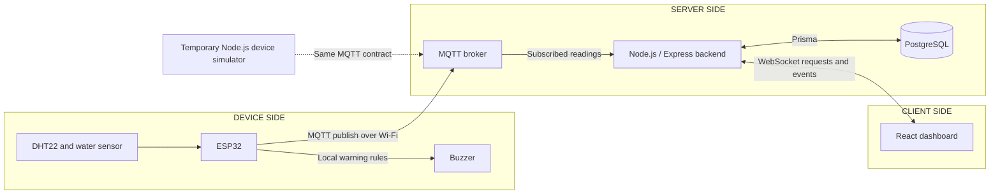

# Communication design: MQTT and WebSocket

**Decision:** ESP32 communicates with the backend through an MQTT broker. React communicates with the backend through WebSocket. This changes transport, not system features: environmental readings, local buzzer, persisted history, incidents and connectivity indicators remain in scope. No staff accounts, remote controls or extra entities are added.

**Implementation status:** proposed contracts, not implemented networking. Existing firmware is a local sensor prototype. The Prisma schema defines Device, SensorReading and Alert; schema validity alone does not establish a migrated database or working integration. Broker product, client libraries and deployment settings remain implementation choices.

## Architecture



The broker routes device messages; the backend validates, runs alert logic and persists results. Publish dashboard events only after the database transaction commits. The browser never connects directly to PostgreSQL or receives device/broker credentials. The device targets the broker's reachable LAN address, not localhost. Protocols are bidirectional, but remote device commands are not part of this system.

## Proposed MQTT contract

Topic: `dsms/<deviceCode>/readings`, for example `dsms/DOC-ROOM-01/readings`.

```json
{
  "deviceId": "DOC-ROOM-01",
  "readingUid": "550e8400-e29b-41d4-a716-446655440000",
  "temperatureC": 28.5,
  "humidityPercent": 68.2,
  "waterDetected": false
}
```

- Payload `deviceId` remains the public **Device.deviceCode** for continuity with the original payload. Database SensorReading.deviceId is the internal integer foreign key. Resolve the code before insertion and require it to match the authorized topic.
- Give each device unique broker credentials and a topic ACL allowing only its own publications. The backend subscribes with a separate restricted account. A payload's device code alone does not authenticate its sender. No HTTP X-DEVICE-KEY or Device.apiKeyHash is part of this design; credential storage follows the selected broker configuration.
- Proposed telemetry settings: QoS 1 publish and subscription, `retain=false`. Choose an ESP32 library that supports the required publish QoS before implementing. QoS 1 may redeliver; it does not guarantee a database commit. Do not use retained old telemetry as a newly received measurement.
- `readingUid` is nullable in the schema for compatibility. For the MQTT producer, generate a new stable ID per measurement and reuse it on retries. Enforce `(deviceId, readingUid)` uniqueness. A duplicate must not restart incident timers or refresh the original receivedAt. Without an ID, application deduplication cannot be guaranteed.
- Validate known/enabled device, finite temperature/RH, RH 0..100, boolean waterDetected, bounded ID/payload lengths, and the agreed sensor temperature range. Reject and log malformed, unauthorized or conflicting duplicate messages without storing them. Never send NAN, fabricated zero values or old data disguised as a new sample.
- The initial proposed periodic publish interval remains 60 seconds. Water transitions should be published promptly after confirmation, independently of that interval; this is pending firmware behavior. Local checks/buzzer must not block on network operations.
- Do not claim offline replay. A persistent offline buffer, historical sample timestamps and replay policy are not implemented. Broker or database failures can cause gaps; record failures and display stale data. A broker PUBACK is not an application-level storage receipt. Any future application acknowledgment/retry mechanism must be explicitly designed and tested.

## Proposed WebSocket contract

Use a single browser connection, for example `ws://<backend-LAN-IP>:3000/ws` on the controlled LAN. Validate origin, message type, device scope, payload size and query limits. Browser requests are read-only. Express may still serve an HTTP health endpoint and static assets; readings and dashboard data use the selected MQTT/WebSocket paths, not REST polling or SSE.

Proposed plain-WebSocket JSON envelope:

```json
{
  "type": "dashboard.get",
  "requestId": "request-1",
  "payload": { "deviceCode": "DOC-ROOM-01" }
}
```

| Client request | Server response | Purpose |
|---|---|---|
| `dashboard.get` | `dashboard.snapshot` | Device metadata, latest reading or null, active alerts, risk and freshness |
| `readings.get` | `readings.result` | Measurement history |
| `alerts.get` | `alerts.result` | Incident history |

Responses echo requestId. History payloads accept deviceCode, from/to timestamps and limit (proposed default 100, maximum 500), with stable timestamp/ID ordering. History responses contain an items array; invalid requests return `error` with requestId and a safe code/message, never internal SQL or secrets.

Server pushes after persistence: `reading.created`, `alert.changed`; a backend timer also pushes `device.status` when readings become stale/offline without new ingestion. Include deviceCode, record identifiers and timestamps in data messages. Send the complete current alert in alert.changed so edits/clearances can replace the matching record. No socket event is a database record until persistence succeeds.

Connect/reconnect behavior: request a fresh snapshot and relevant history. Implement heartbeat, retry backoff and request timeouts. A live socket is not proof the ESP32 is reporting. Prevent a late snapshot from overwriting newer live events: serialize snapshot and subsequent updates for a connection or use a server revision/sequence and reconciliation. Specify and test the chosen ordering before calling synchronization complete. Automatic reconnect is not durable event replay.

Library choice remains open: native browser WebSocket plus a compatible server library, or Socket.IO on both ends with the equivalent event contract. Socket.IO is not wire-compatible with a plain WebSocket client. If selected for strictly WebSocket transport, configure it accordingly instead of silently relying on long-polling fallback.

## Security and failure boundaries

- Run initial read-only monitoring on the authorized private LAN. Check browser Origin explicitly; CORS settings alone do not protect WebSocket upgrades. Rate-limit messages and bound send queues for slow clients.
- Use MQTT over TLS and WSS when crossing untrusted networks. Never expose a development broker anonymously. Public deployment and staff authentication remain outside the agreed scope.
- Broker unavailable: device retries without blocking local sensing; backend/UI report dependency or stale-data state.
- Database unavailable: do not announce a saved reading; log failures. MQTT delivery alone cannot establish data completeness.
- Browser unavailable: backend persistence continues while its dependencies work. Reload state/history after reconnect.
- Device silence: derive NO DATA/ONLINE/STALE/OFFLINE from persisted reading freshness under the SRS thresholds. Device.isActive is ingestion permission, not connectivity.

## Verification targets

Test topic ACLs and spoofed identity, invalid JSON/ranges, duplicate readingUid, broker/database outages, water and timed humidity incidents, snapshot/event ordering, browser reconnect/history, and bounded history requests. Record simulator observations separately from actual physical measurements. Preserve the same measurement contract when replacing the Node simulator with the ESP32.

Sources: [MQTT overview](https://mqtt.org/), [WebSocket API](https://developer.mozilla.org/en-US/docs/Web/API/WebSockets_API), [Socket.IO protocol distinction](https://socket.io/docs/v4/).
