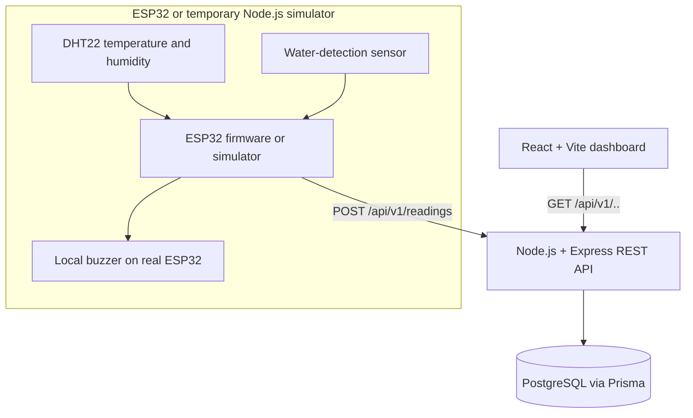
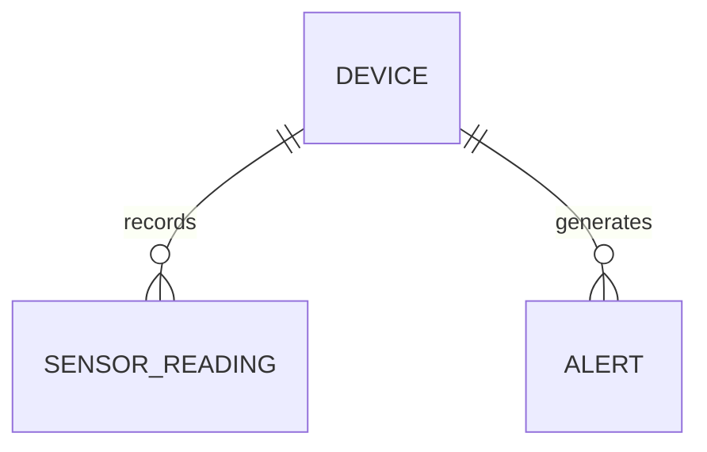

# DSMS Development

> Companion to `SRS.md` and `ERD.md`. This guide explains how to begin **before purchasing the ESP32**, while keeping compatibility with Node.js, Express, REST APIs, and a React frontend.

## 1. Architecture and responsibility boundaries



- **ESP32 firmware** reads sensors and activates local alerts even without Wi-Fi.
- **Express backend** authenticates ingestion, validates readings, runs server alert rules, stores/retrieves data, and serves REST endpoints.
- **PostgreSQL/Prisma** stores historical readings and incidents.
- **React/Vite frontend** renders the data returned by Express; it never reads sensors or queries PostgreSQL directly.

## 2. Exact first steps on Windows PowerShell

Verify existing tools before installation:

```powershell
node --version
npm --version
git --version
```

A supported current **Node.js LTS** version is recommended; confirm supported versions for your chosen Vite and Prisma versions.

Create the workspace:

```powershell
mkdir document-storage-monitor
cd document-storage-monitor
git init
mkdir backend, firmware, docs
npm create vite@latest frontend -- --template react
```

Set up the React app:

```powershell
cd frontend
npm install
npm install recharts lucide-react
cd ..
```

Set up a basic JavaScript Express API **before installing Prisma**:

```powershell
cd backend
npm init -y
npm pkg set type=module
npm pkg set "scripts.dev=nodemon src/server.js"
npm pkg set "scripts.start=node src/server.js"
npm install express cors dotenv zod
npm install --save-dev nodemon
mkdir src, scripts, tests
mkdir src/routes, src/controllers, src/services, src/middleware
cd ..
```

Create `src/app.js`, `src/server.js`, and your first `/api/v1/health` route manually. Configure private-network access and CORS only for the frontend origin. Add `.env.example`, `.gitignore`, and `README.md` before committing.

## 3. Recommended dependency list

| Package / tool                                                   | Stage                  | Purpose                             |
| ---------------------------------------------------------------- | ---------------------- | ----------------------------------- |
| `react`, `react-dom`, `vite`                                     | From frontend scaffold | Frontend application                |
| `recharts`, `lucide-react`                                       | Early frontend         | Trends and icons                    |
| Tailwind CSS                                                     | Optional later         | Styling; plain CSS works initially  |
| `express`, `cors`, `dotenv`, `zod`                               | Start backend          | API, local config, validation       |
| `nodemon` (dev-only)                                             | Start backend          | Auto-restart API on file changes    |
| PostgreSQL server                                                | Database stage         | Persistent data                     |
| `prisma`, `@prisma/client` and version-specific adapter packages | Database stage         | ORM, migrations and database access |
| Postman or Bruno                                                 | API stage              | Manual REST testing                 |
| PlatformIO or ESP-IDF tools                                      | Hardware stage         | ESP32 firmware build/upload         |

**Prisma version warning (important for 2026):** Prisma 7's default `prisma-client` generator emits TypeScript and uses a required output directory plus driver adapter for PostgreSQL. If you intend to stay in a JavaScript-only Express project, deliberately choose and document a compatible approach before installing database packages; alternatively use TypeScript for the backend. Follow the **same major-version** documentation for generator, adapter, configuration, and imports. Official: <https://www.prisma.io/docs/orm/v7>.

## 4. Folder structure

```text
document-storage-monitor/
├── frontend/
│   ├── src/components/
│   ├── src/pages/
│   ├── src/services/api.js
│   ├── .env.example
│   └── package.json
├── backend/
│   ├── prisma/schema.prisma
│   ├── src/app.js
│   ├── src/server.js
│   ├── src/routes/
│   ├── src/controllers/
│   ├── src/services/
│   ├── src/middleware/
│   ├── scripts/simulate-device.js
│   ├── tests/
│   ├── .env.example
│   └── package.json
├── firmware/
├── docs/
│   ├── SRS.md
│   ├── ERD.md
│   └── DEVELOPMENT_GUIDE.md
├── .gitignore
└── README.md
```

Create `docs/` contents by copying the companion files from this package. Do not commit `.env`, database passwords, device keys, `node_modules`, build directories, or firmware secrets.

## 5. How to work without hardware

1. Implement `GET /api/v1/health` in Express.
2. Implement `POST /api/v1/readings` with Zod and **in-memory storage** for the first API tests.
3. Write `backend/scripts/simulate-device.js` to send the same JSON that an ESP32 will eventually produce.
4. Verify valid, invalid, missing-key, wet, and prolonged-high-humidity scenarios in Postman/Bruno.
5. Add PostgreSQL, Prisma, database migration, and a seed with device code `DOC-ROOM-01`.
6. Build `GET /api/v1/dashboard/summary`, `GET /api/v1/readings`, and `GET /api/v1/alerts`.
7. Build React dashboard cards/charts from the **actual API** rather than hard-coded mock values.
8. Implement rule-engine unit tests with a fake clock so long-duration RH cases can be tested quickly.
9. When parts arrive, compile ESP32 firmware and point HTTP POST to the laptop's LAN IP.

### Simulator API body

```json
{
  "deviceId": "DOC-ROOM-01",
  "temperatureC": 28.4,
  "humidityPercent": 68.2,
  "waterDetected": false
}
```

The local dev server endpoint is typically `http://localhost:3000/api/v1/readings` from a simulator running on your computer, but the actual ESP32 requires something like `http://192.168.x.x:3000/api/v1/readings` using **your laptop's real LAN IP** and a private-network firewall rule. Do not expose development secrets on the public internet.

## 6. Creating a Mermaid ERD in VS Code

### Option A — Built-in Markdown preview (recommended)

Current VS Code (version **1.121 and later**) already has built-in Mermaid rendering. You do **not** need to install a separate extension for Mermaid fenced blocks in `.md` files.

1. Open your repository in VS Code.
2. Create `docs/ERD.md` or open the provided one.
3. Add a Mermaid code fence:

````markdown

````

4. Press **Ctrl+Shift+V** to open Markdown Preview. For side-by-side, press **Ctrl+K**, then **V**.
5. The diagram renders. Edit the Mermaid text and save; the preview updates.

### Option B — Older VS Code

If the diagram displays as plain code, first check your VS Code version and whether its built-in `Mermaid Markdown Features` extension is enabled. If you're on a version older than 1.121, update VS Code or install a compatible Markdown Mermaid preview extension. The older `Markdown Preview Mermaid Support` extension was deprecated after its capabilities were merged into VS Code.

### Mermaid relationship symbols

- `||` — exactly one.
- `o{` — zero or many.
- `|{` — one or many.
- Example `DEVICE ||--o{ SENSOR_READING : records` means **one device may have zero or many readings**, but **each reading belongs to exactly one device**.

The ERD visualizes data design. Creating an ERD does **not** create PostgreSQL tables; write `schema.prisma` and run Prisma migrations when database integration begins.

## 7. Recommended order of coding

| Milestone             | Concrete completion check                                            |
| --------------------- | -------------------------------------------------------------------- |
| 1 — API               | Health endpoint and validated POST route return documented responses |
| 2 — Simulator         | Script sends normal/warning/wet readings to Express                  |
| 3 — Database          | Accepted readings persist through backend restart                    |
| 4 — Alert rules       | Persistence, escalation, water detection, and recovery tests pass    |
| 5 — Frontend          | Dashboard shows latest real API data and history                     |
| 6 — Offline detection | UI marks stale/offline data appropriately                            |
| 7 — ESP32             | Physical readings can replace simulator with no API rewrite          |
| 8 — Validation        | Research experiments and acceptance tests documented                 |

## 8. Source links

- VS Code Markdown and Mermaid: <https://code.visualstudio.com/docs/languages/markdown>
- VS Code 1.121 Mermaid integration: <https://code.visualstudio.com/updates/v1_121/>
- Mermaid ERD syntax: <https://mermaid.js.org/syntax/entityRelationshipDiagram.html>
- Prisma 7 version-specific documentation: <https://www.prisma.io/docs/orm/v7>

**First goal:** Submit one simulated reading to Express, persist it, retrieve it over REST, and display it in a React card. The sensor hardware can come later.
