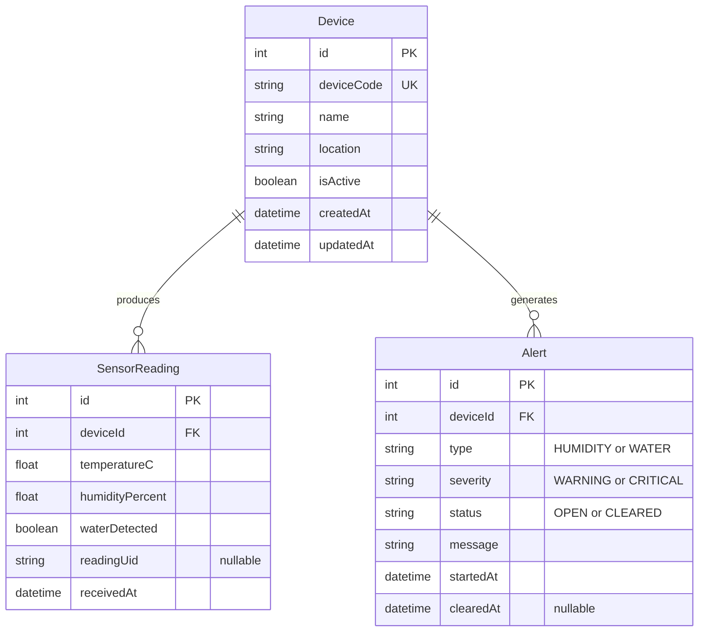

# DSMS entity relationship diagram

Aligned with `backend/prisma/schema.prisma`. Three entities support the agreed monitoring features; MQTT/broker and WebSocket are communication infrastructure, not database entities. No staff-account or expansion model is included.

## Identity and relationships

- All three primary keys are auto-incrementing integers. Child deviceId fields reference Device.id with restrictive deletion.
- Device.deviceCode is unique, e.g. DOC-ROOM-01. MQTT payload deviceId is this public code; the backend checks it against the authorized topic and resolves the integer foreign key.
- Device.isActive enables/disables ingestion; connectivity is derived separately from reading freshness.
- No apiKeyHash field: the chosen broker owns its authentication configuration. A device code is not a credential. PostgreSQL credentials belong to backend configuration only.
- An incident can span many readings, so Alert relates to Device rather than one SensorReading.
- DateTime fields use TIMESTAMPTZ(3); createdAt/receivedAt/startedAt default to now. Device.updatedAt is maintained by Prisma. clearedAt is null until recovery.

## Constraints and migration status

The current schema and initial migration `20261110104250_database_connection` include:

- Unique deviceCode.
- Unique (deviceId, readingUid). Null readingUid does not provide deduplication; MQTT producers should supply a stable ID per measurement and reuse it on retries.
- Indexes on (deviceId, receivedAt) and (deviceId, startedAt).
- Foreign keys with ON DELETE RESTRICT.

Still required in a follow-up migration/service implementation:

1. At most one OPEN alert per (deviceId, type), enforced with a partial unique index. A general unique index on (deviceId, type, status) would wrongly restrict cleared history.
2. Finite/range validation for measurements, including humidity 0..100, with database checks as appropriate.
3. Status/clearedAt consistency: OPEN has no clearance timestamp, CLEARED has one; clearance cannot precede start.
4. Atomic reading/incident changes and safe deduplication under concurrent delivery.

The migration file exists; this document does not claim it has been applied to a particular database. Preserve already-applied migrations; add new constraints through a new migration. The Mermaid diagram does not execute SQL.

See [communication contracts](COMMUNICATION.md), [SRS](SRS.md), and [development guide](DEVELOPMENT_GUIDE.md).
