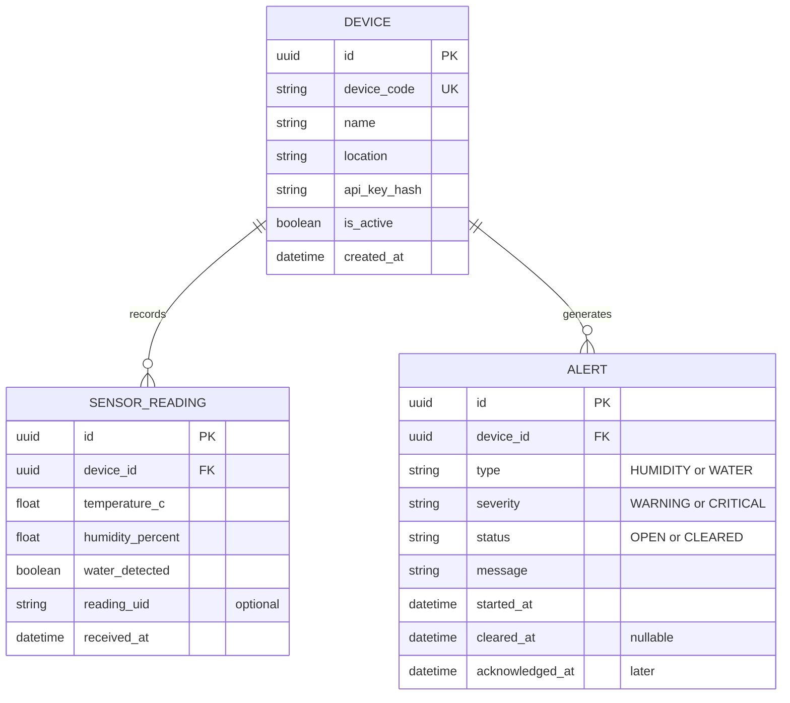
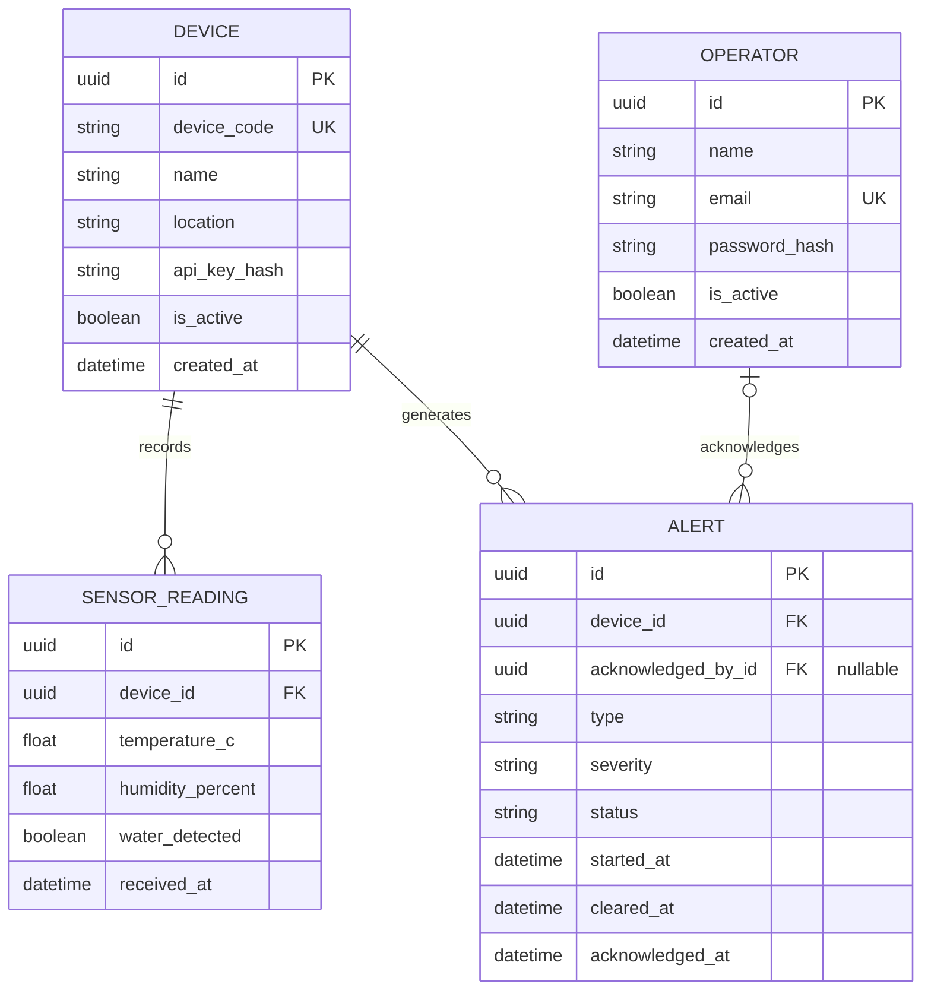

# DSMS — Entity Relationship Diagram (ERD)

**Project:** ESP32-Based Early-Warning System for Humidity and Water Intrusion in School Document Storage Areas
**Status:** Version 1 logical data model (three core tables).
**Database:** PostgreSQL; ORM: Prisma.
**Scope:** One ESP32, one monitoring area, environmental telemetry and alerts.

## Version 1 — Core ERD

## Relationship explanation

- **DEVICE 1 : 0..many SENSOR_READING** — each reading comes from exactly one ESP32 device, while a device may produce zero or thousands of measurements.
- **DEVICE 1 : 0..many ALERT** — each alert is associated with exactly one ESP32 device; a device may have multiple incidents over time.
- There is deliberately **no direct SENSOR_READING-to-ALERT foreign key**: an alert is the result of a _period of readings_ (humidity) or a wet-sensor state and belongs to its device. A particular alert may be caused by several readings rather than one.

## Primary and foreign keys

| Entity         | Key                                | Note                                                                         |
| -------------- | ---------------------------------- | ---------------------------------------------------------------------------- |
| DEVICE         | `id` primary; `device_code` unique | `device_code` (e.g., `DOC-ROOM-01`) is exposed as `deviceId` in API requests |
| SENSOR_READING | `id` primary; `device_id` foreign  | Optional `(device_id, reading_uid)` unique pair for retry deduplication      |
| ALERT          | `id` primary; `device_id` foreign  | Prevent more than one `OPEN` alert per `(device_id, type)`                   |

## Proposed database constraints

1. `humidity_percent` between 0 and 100, and `temperature_c` must be finite and sensor-plausible.
2. `type` is `HUMIDITY` or `WATER`; `severity` is `WARNING` or `CRITICAL`; `status` is `OPEN` or `CLEARED`.
3. `cleared_at` is nullable while status is `OPEN`, and should be set when status becomes `CLEARED`.
4. Index `(device_id, received_at DESC)` for readings and `(device_id, started_at DESC)` for alerts.
5. Use a partial unique database index (or a suitable transaction and locking strategy) to prevent two open alerts with the same `(device_id, type)`.
6. The physical database schema/migrations are the final source of truth; Mermaid is an editable visualization and does not generate the database automatically.

## Later extension — Authenticated staff acknowledgment

Only use this extension if the team adds staff login and protects `PATCH /api/v1/alerts/:id/acknowledge`.

For the MVP, **use the first, three-entity diagram**. It matches the simplified project scope and does not require login before sensor monitoring works.
