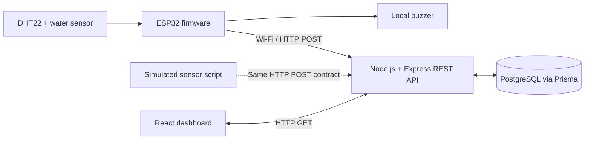
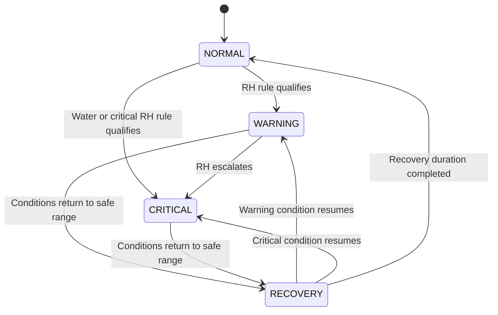
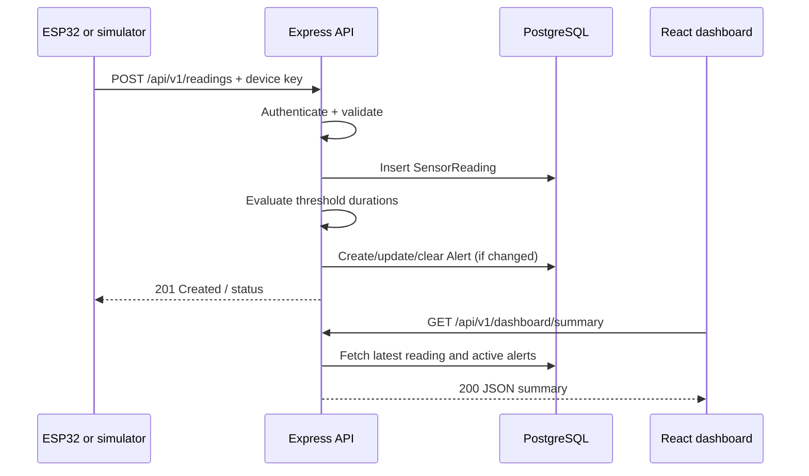
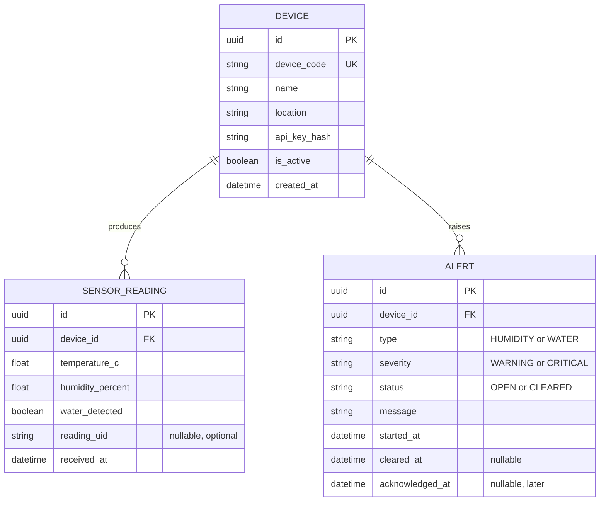

# Software Requirements Specification (SRS)

## ESP32-Based Early-Warning System for Humidity and Water Intrusion in School Document Storage Areas

| Document field | Value |
|---|---|
| Document type | Software Requirements Specification (SRS) |
| Document ID | SRS-DSMS-001 |
| Version | 1.0 — Baseline Draft for Team Review |
| Date | November 5, 2026 |
| Project acronym | DSMS (Document Storage Monitoring System) |
| Deployment | One school document-storage area; one ESP32 prototype |
| Technology | ESP32 + DHT22 + water sensor + buzzer; React/Vite; Node.js/Express REST API; PostgreSQL/Prisma |
| Status | Draft: implementation details and acceptance targets require team/instructor approval |

> **Requirement status key:** **Baseline** = carried forward from the group's visual project guide; **Proposed** = implementation decision added to make the requirements testable; **Later** = explicitly excluded from the first working release. All times, thresholds, performance targets, and policies marked *Proposed* must be approved or revised during design review. This document describes the intended system; it does not claim the system has already been implemented, validated, or approved by a school.

---

## Document control

| Revision | Date | Summary | Approval |
|---|---|---|---|
| 1.0 | 2026-11-05 | Initial detailed SRS drafted from the supplied visual guide and subsequent development discussions | Pending |

**Primary project source:** *ESP32 Document Storage Monitoring — Full Visual Guide* (November 2026), itself based on the group's original *Early-Warning System for Humidity and Water Intrusion in School Document Storage Areas* draft. The source established the project scope, four core functions, ESP32-only controller, component list, basic architecture, proposed alert rules, three database models, endpoints, and research objectives. Details not fixed by that guide are labeled *Proposed* or *Later* here.

**Approval responsibilities (to fill in):** Project group: __________; Faculty adviser/instructor: __________; Target storage-area representative: __________.

## 1. Introduction

### 1.1 Purpose

This SRS defines the required behavior, interfaces, data, quality attributes, constraints, and acceptance criteria for DSMS. It will guide software development, ESP32 firmware integration, testing, and research evaluation. Intended readers are the project members, instructor, adviser, evaluators, and prospective storage-area staff.

### 1.2 Problem statement

Schools retain paper records such as student files, certificates, enrollment documents, and administrative papers. Prolonged high relative humidity may contribute to conditions favorable to mold, while direct water intrusion may physically damage documents. Occasional manual inspections may miss developing incidents. DSMS shall provide continuous monitoring and earlier warnings **of environmental conditions**, not a guarantee of document preservation.

### 1.3 Product scope

**In scope — Version 1 (Baseline):**

1. Monitor air temperature and relative humidity near one document-storage location using one DHT22 sensor connected to one ESP32.
2. Detect water contacting a water-sensor plate installed near a plausible leak point.
3. Apply local warning rules and operate an audible buzzer even if Wi-Fi is temporarily unavailable.
4. Upload readings via Wi-Fi and HTTP to a Node.js/Express REST API.
5. Validate, persist, and retrieve readings in PostgreSQL through a data-access layer (Prisma is recommended).
6. Show current temperature, relative humidity, water status, warning state, device connectivity, and timestamps on a React dashboard.
7. Display reading history and alert/incident history for the monitored area.
8. Support test inputs from a software simulator before physical components are available.
9. Test measurement error, warning response time, false alarms, water-detection success, and data completeness.

**Out of scope — Version 1:** automatic dehumidification, automatic pumps/valves, mold identification, direct measurements inside documents, autonomous room climate control, multiple rooms, AI prediction, cloud/SMS integrations, public internet deployment, commercial archival certification, and camera surveillance. A protected operator login and alert acknowledgment are **Later** features (see Section 11).

### 1.4 Objectives

**General objective:** Develop and evaluate a low-cost ESP32-based system that monitors humidity and water intrusion and provides early warnings in a school document-storage area.

**Specific objectives:** (SO-01) acquire temperature/humidity and water-detection data; (SO-02) generate persistent-condition and immediate-wetness alerts; (SO-03) store and visualize readings/incidents through a REST-based dashboard; (SO-04) evaluate accuracy, alert responsiveness, reliability, and false-alarm behavior through controlled testing.

### 1.5 Definitions and abbreviations

| Term | Definition |
|---|---|
| ESP32 | Wi-Fi-capable microcontroller used as the **only** microcontroller board |
| DHT22 | Digital sensor measuring ambient temperature and relative humidity |
| Relative humidity (RH) | Percentage measure of water vapor in air relative to saturation at the same temperature |
| Water intrusion | Water detected at the installed probe's physical location |
| Reading | One device report containing temperature, RH, wet/dry status, and a receipt timestamp |
| Alert / incident | Recorded interval in which a warning condition is active |
| REST API | HTTP interface used by the ESP32 simulator/device and the web dashboard |
| Stale data | Last reading too old to describe current conditions reliably |
| MVP | Minimum viable prototype: the Version 1 scope |
| UTC | Coordinated Universal Time, used for stored timestamps |
| LAN | Local area network connecting device, browser, and backend |

### 1.6 References

- Group source: *ESP32 Document Storage Monitoring — Full Visual Guide*, November 2026.
- Library of Congress, *How do I preserve my letters or paper documents?* — <https://ask.loc.gov/preservation/faq/445765>.
- U.S. National Archives, *How to Preserve Family Archives* — <https://www.archives.gov/preservation/family-archives/storing>.
- Mermaid ER diagram syntax — <https://mermaid.js.org/syntax/entityRelationshipDiagram.html>.
- VS Code Markdown and Mermaid preview — <https://code.visualstudio.com/docs/languages/markdown>.

The preservation sources explain environmental risks; they do **not** automatically validate particular alert thresholds or assert that a wet/dry plate measures moisture inside paper.

---

## 2. Overall description

### 2.1 System perspective

DSMS has four parts:

1. **Physical monitoring node** — ESP32 reads the DHT22 and water-detection module, applies local rules, operates the buzzer, and sends readings.
2. **Express REST API** — authenticates the device, validates readings, processes alert rules, and exposes data for the dashboard.
3. **PostgreSQL database** — stores a device record, time-series readings, and incident records.
4. **React dashboard** — displays the latest state, histories, and connectivity indicators.



**No physical parts are required to build and verify the API, persistence layer, simulator, or dashboard.** The simulator replaces the ESP32 as the *producer of readings* only; backend and frontend contracts must remain the same.

### 2.2 Users and stakeholders

| Actor | Interest / permitted behavior |
|---|---|
| Storage caretaker / school staff | View current status, trends, incidents, and device connectivity; inspect conditions after a warning |
| Project developer/tester | Configure test thresholds, run simulations, inspect APIs, validate hardware and measurements |
| Instructor / researcher | Evaluate requirements coverage and measured test results |
| ESP32 / simulator (machine actor) | Submit readings using a device-specific credential; cannot perform staff operations |

**Proposed MVP access model:** dashboards run only on a trusted school/lab private LAN and are read-only. Private network placement is not a substitute for authentication if the system is later opened to other users or networks. Protected staff actions are reserved for a later phase.

### 2.3 Operating environment

- One ESP32 DevKit-style board, with on-board Wi-Fi and appropriate regulated USB power.
- DHT22 sensor module, basic exposed-electrode water-detection module, and compatible active buzzer module.
- Laptop/desktop running a compatible current Node.js LTS runtime, Express backend, PostgreSQL, and the Vite development server.
- Modern browser on desktop or mobile connected to the same authorized local network.
- Firmware written in C/C++ using an ESP32-compatible development environment. **No Arduino microcontroller board.** If the course disallows the Arduino *software framework*, use Espressif ESP-IDF; otherwise PlatformIO and its ESP32 framework choice must be approved.

### 2.4 Constraints and dependencies

- Version 1 uses **one ESP32, one DHT22, one water-sensing location, and one buzzer**.
- ESP32 GPIOs are 3.3V logic; no 5V sensor output may directly drive a GPIO.
- Sensor module wiring, trigger polarity, and USB connector vary by purchased model and must be checked against datasheets.
- Local buzzer operation must not depend on the network, backend, database, or React application being online.
- Reading receipt and incident history require a working server/database. An offline buffered upload queue is **not** a required Version 1 feature.
- Long-term operation of low-cost exposed-electrode water probes requires inspection for corrosion and false triggers.
- Preset RH thresholds are **experimental starting points** and require site-specific review.

### 2.5 Assumptions

- The ESP32 and backend can reach each other on a trusted private network in integration testing.
- The monitored storage space permits sensor installation and safe routing of power/signal wiring.
- The project group has access to a laptop, internet for package installation, and a reference hygrometer during validation.
- No personally identifiable information from stored school records is collected; DSMS measures environmental conditions, not document contents.

---

## 3. External interface requirements

### 3.1 Hardware interfaces

| Component | Proposed interface | Function / constraint |
|---|---|---|
| DHT22 module | VCC 3.3V, GND, DATA to GPIO 4 | Read temperature °C and RH %; bare DHT22 may need pull-up resistor |
| Water-detection module | VCC/GND as supported; DO to GPIO 27 | Digital wet/dry input; check output is ESP32-safe |
| Active buzzer | SIG GPIO 26 + compatible supply/driver | Provide local audible warning; confirm active-high/active-low |
| ESP32 power | Suitable USB cable and regulated 5V USB power | Maintain safe continuous operation |
| Alternative analog water input | ADC1-capable GPIO such as GPIO 34 | **Optional** only if the purchased module uses analog output |

These GPIO assignments are **proposed starting values**, not final wiring instructions. Complete pinout validation after hardware is purchased. Locate the DHT22 in representative ambient air and the water plate low near the identified intrusion risk; protect the ESP32 from wetting.

### 3.2 Software interfaces

- **Firmware -> backend:** HTTP JSON request to `POST /api/v1/readings` with an `X-DEVICE-KEY` header.
- **Frontend -> backend:** read-only REST `GET` requests; browser must never contact database or access device secrets directly.
- **Backend -> database:** Prisma client and PostgreSQL using parameterized ORM queries and schema migrations.
- **Configuration:** environment variables for database connection, API listening port, allowed browser origin, and device-key secrets. No secrets in Git.

### 3.3 User interface requirements

| UI area | Required content |
|---|---|
| Dashboard | Area/device label, temperature, RH, wet/dry state, overall warning severity, last update |
| History chart | Time-series temperature and RH with range selection and accessible labels |
| Incident history | Alert type, severity, start, acknowledgement if implemented later, cleared time |
| Connectivity | ONLINE / STALE / OFFLINE badge and a visible last-received timestamp |
| Empty/error states | Descriptive text when no readings, API connection errors, or outdated values occur |

The first release may implement these as sections of a **single page**. Do not require separate authentication or multi-page routing to meet the MVP.

### 3.4 Communication interfaces

- JSON over HTTP on the local LAN for development; HTTPS is required before any deployment across untrusted networks.
- Content type `application/json; charset=utf-8`.
- Server-generated timestamps are ISO 8601 UTC in API responses and stored in UTC in PostgreSQL.
- Use the laptop's **LAN IP address**, not `localhost`, as the ESP32's server target.
- Backend CORS allow-list shall contain only the explicit frontend development/deployment origins.

---

## 4. Functional requirements

**Priorities:** **MUST** = release-blocking MVP requirement; **SHOULD** = strongly recommended for release readiness; **LATER** = excluded from MVP. Each requirement is independently testable. Unless noted otherwise, these requirements are *Proposed* elaborations of the baseline features.

### 4.1 Device acquisition and local warnings

| ID | Priority | Requirement | Verification |
|---|---|---|---|
| FR-001 | MUST | Read valid temperature and RH values from the DHT22 on the ESP32. | Controlled DHT22 test |
| FR-002 | MUST | Read a wet/dry state from the installed water sensor. | Dry/wet probe trials |
| FR-003 | MUST | Provide a configurable acquisition interval; initial target **60 seconds** for temperature/RH (*Proposed*). | Timestamp inspection |
| FR-004 | MUST | Ignore and flag failed/invalid sensor reads rather than using placeholder numbers as real measurements. | Disconnect/invalid read test |
| FR-005 | MUST | Activate the local buzzer when water is detected, without relying on Wi-Fi. | Wi-Fi disabled, wet probe |
| FR-006 | MUST | Implement local humidity warning criteria consistent with Section 5 using measured elapsed time, not a simple one-sample threshold. | Simulated-duration test |
| FR-007 | SHOULD | Use a short, configurable confirmation/debounce for intermittent water-sensor noise, while warning promptly for sustained wet detection. | Repeatable brief/sustained wet pulses |
| FR-008 | MUST | Restart into a safe monitoring state after power restoration and reconnect Wi-Fi without blocking local sensor checks. | Restart/network outage test |
| FR-009 | MUST | Never present stale cached sensor readings as new observations. | Network/reboot test |

### 4.2 Sensor submission and validation

| ID | Priority | Requirement | Verification |
|---|---|---|---|
| FR-010 | MUST | Submit the current sensor state as JSON to `POST /api/v1/readings` at a configurable interval, initially **60 seconds** (*Proposed*). | API log inspection |
| FR-011 | MUST | Accept the same JSON payload from the ESP32 or the Node.js simulator. | Contract comparison |
| FR-012 | MUST | Authenticate ingestion requests with a per-device secret; unknown/inactive devices shall be rejected. | Unauthorized request tests |
| FR-013 | MUST | Validate `deviceId`, finite temperature/RH numbers, and boolean `waterDetected`; reject malformed payloads with a structured error. | Zod schema tests |
| FR-014 | MUST | Record a server-generated `receivedAt` timestamp on successful storage. | Database inspection |
| FR-015 | SHOULD | Support a unique optional `readingId` to deduplicate retried submissions; when present, repeated requests shall not create a second measurement. | Duplicate POST test |
| FR-016 | MUST | Return a documented success/error response and appropriate HTTP status. | API tests |

### 4.3 Persistence, alert creation, and lifecycle

| ID | Priority | Requirement | Verification |
|---|---|---|---|
| FR-017 | MUST | Store each accepted observation with its related device. | DB foreign-key test |
| FR-018 | MUST | Determine humidity warning eligibility based on continuous qualifying readings over elapsed time. | Alert timer unit test |
| FR-019 | MUST | Create a critical water-intrusion alert promptly upon confirmed wet detection. | Water test |
| FR-020 | MUST | Avoid duplicate **active alerts of the same type** for one device; new observations update the existing incident. | Repeated POST test |
| FR-021 | MUST | Support severity escalation from humidity WARNING to CRITICAL within the same incident. | Escalation test |
| FR-022 | MUST | Record when an incident starts and clears, preserving its highest severity reached. | Incident timeline test |
| FR-023 | MUST | Keep humidity and water incidents independent so both can exist simultaneously. | Combined-condition test |
| FR-024 | MUST | Recalculate a device's overall displayed severity from current incident states: CRITICAL before WARNING before NORMAL. | Priority test |
| FR-025 | SHOULD | Automatically resolve an active warning only after the condition meets a documented recovery rule (Section 5). | Recovery test |
| FR-026 | MUST | Return history records in stable timestamp order and support bounded queries. | Pagination and ordering test |

### 4.4 Dashboard and reporting

| ID | Priority | Requirement | Verification |
|---|---|---|---|
| FR-027 | MUST | Display the newest accepted temperature, humidity, water state, and received-at time. | Browser/API comparison |
| FR-028 | MUST | Distinguish NORMAL, WARNING, CRITICAL, STALE, and OFFLINE states; missing data shall not be treated as NORMAL. | State cases |
| FR-029 | MUST | Show historical measurements as a time-series chart. | Chart inspection |
| FR-030 | MUST | Show a table of incidents with event type, severity, start, state, and cleared time if available. | Incident table test |
| FR-031 | MUST | Show a helpful empty state when no reading exists for the selected device. | Empty DB test |
| FR-032 | MUST | Handle API failures and display a visible error/retry state rather than silently keeping stale values. | Stop API test |
| FR-033 | SHOULD | Poll the REST API every **10 seconds** for summary/current state (*Proposed*); chart history may load on demand. | Browser network inspection |
| FR-034 | SHOULD | Filter history by a bounded interval (e.g., 24 hours or 7 days) and display units and timestamps clearly. | Filter test |

### 4.5 Testing and simulation

| ID | Priority | Requirement | Verification |
|---|---|---|---|
| FR-035 | MUST | Provide a Node.js simulator that sends normal, warning, critical, dry, and wet readings using the same API contract as the ESP32. | Simulator runs |
| FR-036 | MUST | Permit automated tests of persistence timing using a controlled/test clock or configurable thresholds, without physically waiting 30 minutes for every case. | Unit test suite |
| FR-037 | MUST | Provide a documented health endpoint for verifying API process status and database dependency status. | Health checks |
| FR-038 | SHOULD | Capture test results for sensor error, detection accuracy, alert latency, false alarms, and accepted-versus-sent readings. | Research report |

### 4.6 Later, protected administration (not required for first release)

| ID | Priority | Requirement | Verification |
|---|---|---|---|
| FR-L01 | LATER | Authenticate at least one designated staff operator before enabling incident acknowledgment. | Login tests |
| FR-L02 | LATER | Permit an authenticated operator to acknowledge an active incident without falsely marking the physical condition as resolved. | Acknowledge scenario |
| FR-L03 | LATER | Audit who acknowledged an incident and when; log re-escalation events if added. | Audit inspection |
| FR-L04 | LATER | Allow authorized adjustment of thresholds through a protected settings page. | Permission test |

> **Important separation:** An **acknowledged** incident is not necessarily **cleared**. Acknowledgment means a staff member has seen it; clearance must follow sensor conditions. The original guide suggested `PATCH /api/v1/alerts/:id/acknowledge`; this specification retains it as a **Later** endpoint until proper staff authorization exists.

---

## 5. Business rules and warning state machine

### 5.1 Experimental alert thresholds

The original project guide proposed the following test thresholds. They are **not conservation standards** and must be validated with literature, actual storage needs, and controlled experiments.

| Rule ID | Condition | Result | Status |
|---|---|---|---|
| BR-001 | RH < 60% with no water detected | NORMAL unless another active event remains pending recovery | Baseline |
| BR-002 | RH >= 60% continuously for 30 minutes | Humidity WARNING | Baseline; proposed test setting |
| BR-003 | RH >= 65% continuously for 15 minutes | Humidity CRITICAL; escalate active humidity incident if any | Baseline; proposed test setting |
| BR-004 | Water sensor confirms wet state | Water CRITICAL; local buzzer; log incident | Baseline |
| BR-005 | Qualifying RH streak is interrupted by an RH reading below its threshold | Reset the corresponding qualification timer | Proposed |
| BR-006 | RH < 58% for 10 minutes | Clear active humidity incident if no qualifying condition resumes | Proposed hysteresis and recovery rule |
| BR-007 | Water sensor remains dry for 10 seconds | Clear active water incident; retain history | Proposed recovery rule |
| BR-008 | Latest `receivedAt` age > 180 seconds | Mark data STALE even if previous severity was NORMAL | Proposed |
| BR-009 | Latest `receivedAt` age > 300 seconds | Mark device OFFLINE; preserve previously recorded incidents | Proposed |
| BR-010 | No accepted reading has ever been received | Display NO DATA / awaiting first reading, not NORMAL | Proposed |

**Precedence:** Show environmental severity and connectivity separately (e.g., `CRITICAL · device offline`). Never hide an earlier unresolved warning simply because the device stopped reporting. Humidity and water incidents are separate. Implement humidity timers from accepted observations and their receipt timestamps, with a deliberate data-gap policy; missing readings beyond the expected interval must not be interpreted as continuous stable humidity. The duration of a gap that breaks a qualifying streak is **Proposed: 180 seconds**. For precise tests, use controllable time in the service layer.

### 5.2 Incident lifecycle



The diagram describes environmental *rule state*; the database holds one incident per active alert type, with `startedAt` and `clearedAt`. A later operator acknowledgment is a distinct administrative attribute, not a sensor state.

### 5.3 Sample data intervals

| Setting | Initial value | Status |
|---|---|---|
| Temperature/RH sample and POST interval | 60 seconds | Proposed |
| Water contact check | At least once per second or interrupt-driven if hardware supports it | Proposed |
| Dashboard summary refresh | 10 seconds | Proposed |
| Data stale limit | 180 seconds after last accepted reading | Proposed |
| Offline indication | 300 seconds after last accepted reading | Proposed |
| Display timezone | Asia/Manila in browser; UTC in database/API | Proposed |

---

## 6. Use cases and main workflows

### UC-01 — Observe document storage conditions

- **Primary actor:** Storage caretaker.
- **Precondition:** At least one valid reading exists; the dashboard can reach the API.
- **Trigger:** User opens the dashboard.
- **Main flow:** (1) Browser requests summary; (2) API fetches latest reading, active incidents, and device metadata; (3) browser displays RH, °C, wet/dry, latest update, and risk/connectivity status; (4) dashboard refreshes periodically.
- **Alternative flows:** No readings -> show awaiting data; API unavailable -> show connection error; last reading too old -> show STALE/OFFLINE.
- **Postcondition:** User sees current or explicitly out-of-date system status.

### UC-02 — Detect water intrusion

- **Primary actor:** ESP32 / simulator.
- **Precondition:** Water sensor installed, or simulator in wet scenario.
- **Trigger:** Probe changes to wet.
- **Main flow:** (1) ESP32 detects the condition; (2) buzzer activates locally; (3) POST reports wet state when Wi-Fi is available; (4) backend creates/updates the active water incident; (5) frontend shows critical warning.
- **Alternative flow:** Wi-Fi unavailable -> buzzer still activates; remote dashboard does not update and eventually displays stale/offline state.
- **Postcondition:** Local warning exists and any successfully received incident is stored.

### UC-03 — Detect prolonged high humidity

- **Primary actor:** ESP32 and backend.
- **Trigger:** Consecutive valid RH readings remain above a configured threshold for the duration in BR-002 or BR-003.
- **Main flow:** (1) Qualifying period starts; (2) duration reaches threshold; (3) warning/critical alert is activated; (4) backend records the incident; (5) dashboard shows severity and start time.
- **Alternative flow:** Reading falls below threshold or data gap exceeds allowed window -> timer is reset according to the rule.

### UC-04 — Examine incident history

- **Primary actor:** Storage caretaker / researcher.
- **Main flow:** (1) User opens incident table; (2) frontend requests bounded alert records; (3) backend returns incidents with timestamps and current state; (4) user reviews recurring environmental events.
- **Postcondition:** Past incidents remain available after clearance.

### UC-05 — Run without physical hardware

- **Primary actor:** Developer.
- **Precondition:** API and database running; simulator configured with permitted test device key.
- **Main flow:** (1) Developer selects simulator scenario; (2) script submits the standard readings payload; (3) backend validates/stores it and calculates alerts; (4) dashboard shows the result; (5) developer compares API, database, and UI.
- **Postcondition:** Complete software pathway verified before hardware procurement.

### UC-06 — Recover from temporary disconnection

- **Primary actor:** ESP32 / backend.
- **Trigger:** Wi-Fi or server unavailable.
- **Main flow:** (1) Firmware continues sensing and sounding relevant local alarms; (2) failed POST is logged locally/diagnostically; (3) dashboard marks data as STALE/OFFLINE as time passes; (4) on reconnection the device resumes publishing current readings.
- **Postcondition:** Network failures are visible; no fictitious observations are created.
- **Limitation:** Version 1 does not guarantee reconstruction of measurements missed while offline.

---

## 7. REST API specification

### 7.1 General conventions

- Base URL: `http://<backend-LAN-IP>:3000/api/v1` during local prototyping.
- The ESP32 uses the server's LAN IP rather than `localhost`.
- JSON is the request/response format.
- Values use `temperatureC` (degrees Celsius), `humidityPercent` (0–100), and `waterDetected` (boolean).
- Server time is authoritative for persistence-rule evaluation in Version 1; requests may include an optional `readingId` for future deduplication.
- Keys are compared to stored hashes/secure configuration; never store or log plaintext API keys.
- Error envelope: `{ "error": { "code": "INVALID_READING", "message": "...", "details": [] } }`.
- Common errors: `400` malformed data; `401` missing/invalid key; `403` inactive device; `404` unknown resource; `409` conflicting duplicate if not treated idempotently; `429` excessive requests; `500` server error; `503` dependency unavailable.

### 7.2 Endpoint contract table

| ID | Method | Endpoint | Actor | MVP | Behavior |
|---|---|---|---|---|---|
| API-01 | GET | `/api/v1/health` | Developer | Yes | Report process and dependency status |
| API-02 | POST | `/api/v1/readings` | ESP32/simulator | Yes | Authenticate, validate, save, evaluate alerts |
| API-03 | GET | `/api/v1/readings/latest?deviceId=DOC-ROOM-01` | Dashboard | Yes | Return most recent reading or null |
| API-04 | GET | `/api/v1/readings?deviceId=DOC-ROOM-01&limit=100` | Dashboard | Yes | Return ordered readings, bounded to max 500 |
| API-05 | GET | `/api/v1/alerts?deviceId=DOC-ROOM-01&limit=100` | Dashboard | Yes | Return active and historical incidents |
| API-06 | GET | `/api/v1/dashboard/summary?deviceId=DOC-ROOM-01` | Dashboard | Yes | Return latest measurement, active alert summary, connectivity |
| API-07 | PATCH | `/api/v1/alerts/:id/acknowledge` | Authorized staff | **Later** | Acknowledge incident, not clear condition |

The query `deviceId` refers to the **public `deviceCode`** (for example `DOC-ROOM-01`), not the internal database UUID. Documentation, simulator, and API shall consistently use this convention.

### 7.3 POST /api/v1/readings

**Request headers**

```http
Content-Type: application/json
X-DEVICE-KEY: <device-secret>
```

**Required body**

```json
{
  "deviceId": "DOC-ROOM-01",
  "temperatureC": 28.4,
  "humidityPercent": 68.2,
  "waterDetected": false
}
```

**Validation**: `deviceId` nonempty known device code; finite `temperatureC` in an equipment-appropriate permissible interval (initial design check -20 to 80 °C, *Proposed*); finite RH between 0 and 100 inclusive; `waterDetected` true or false, never a string. Do not silently clamp invalid measurements. Optional `readingId` can be a UUID for idempotent retries.

**Example success (`201 Created`)**

```json
{
  "data": {
    "id": "c1a5d3b5-87ab-4d8a-b6ac-cc507c87f4bc",
    "deviceId": "DOC-ROOM-01",
    "temperatureC": 28.4,
    "humidityPercent": 68.2,
    "waterDetected": false,
    "receivedAt": "2026-11-05T05:00:00.000Z"
  },
  "status": {
    "environmentalRisk": "NORMAL",
    "connectivity": "ONLINE"
  }
}
```

An RH of 68.2% **does not automatically mean a 15-minute critical alert exists**: the server must evaluate persistence over time before changing severity. For a first high reading, the risk response may still be NORMAL while qualifying timers accumulate.

### 7.4 GET /api/v1/dashboard/summary

**Example response (`200 OK`)**

```json
{
  "data": {
    "device": { "deviceId": "DOC-ROOM-01", "name": "Records Room Sensor", "location": "Records Room" },
    "latest": {
      "temperatureC": 28.4,
      "humidityPercent": 68.2,
      "waterDetected": false,
      "receivedAt": "2026-11-05T05:00:00.000Z"
    },
    "environmentalRisk": "WARNING",
    "connectivity": "ONLINE",
    "activeAlerts": [
      {
        "id": "a857b8c2-fb08-4b7b-a711-2e5fbb7d1f8a",
        "type": "HUMIDITY",
        "severity": "WARNING",
        "startedAt": "2026-11-05T04:30:00.000Z"
      }
    ]
  }
}
```

This example assumes the RH warning has qualified from earlier accepted readings. When the device is STALE or OFFLINE, `connectivity` changes without overriding the already-recorded `environmentalRisk`.

### 7.5 History API behaviors

- Return a JSON `data` array with newest first for tables; for line charts, the frontend may reverse into ascending time order after retrieval.
- `limit` defaults to 100 and cannot exceed 500 (*Proposed*).
- Permit optional `from` and `to` ISO 8601 timestamps; reject ranges where `from > to`.
- No API shall expose device keys or database credentials.
- Errors shall not return stack traces or internal SQL details to the browser.

### 7.6 API sequence



---

## 8. Data requirements and database design

### 8.1 Database conventions

- PostgreSQL relational database with Prisma schema as the selected ORM representation.
- IDs: internal UUID primary keys; external `deviceCode` is a unique human-readable identifier.
- All times stored as timestamp with timezone (UTC semantics) and returned in ISO 8601 UTC.
- Foreign keys shall preserve relationship integrity; prevent accidental cascade deletion of historical records in the MVP.
- Add indexes appropriate for latest-per-device and history queries.

### 8.2 Core logical ERD



This corresponds to the guide's **three core models**. Mermaid expresses cardinality; it is a visual specification, not an automatically executed SQL migration. The database must enforce constraints separately.

### 8.3 Core data dictionary

**DEVICE**

| Field | Type | Constraints | Description |
|---|---|---|---|
| id | UUID | PK, generated | Internal identifier |
| device_code | VARCHAR(64) | UNIQUE, NOT NULL | External `deviceId` in API |
| name | VARCHAR(120) | NOT NULL | Readable device label |
| location | VARCHAR(200) | NOT NULL | Physical placement description |
| api_key_hash | TEXT | NOT NULL | Stored verifier for device credential |
| is_active | BOOLEAN | NOT NULL DEFAULT true | Whether ingestion is permitted |
| created_at | TIMESTAMPTZ | NOT NULL | Registration time |

**SENSOR_READING**

| Field | Type | Constraints | Description |
|---|---|---|---|
| id | UUID | PK | Reading identifier |
| device_id | UUID | FK -> DEVICE.id, NOT NULL | Originating device |
| temperature_c | DOUBLE PRECISION | NOT NULL, finite | Temperature °C |
| humidity_percent | DOUBLE PRECISION | 0..100, NOT NULL | Air relative humidity |
| water_detected | BOOLEAN | NOT NULL | Sensor wet/dry input |
| reading_uid | VARCHAR(64) | NULL, UNIQUE with device_id when present | Optional deduplication ID |
| received_at | TIMESTAMPTZ | NOT NULL | Server receipt time |

**ALERT**

| Field | Type | Constraints | Description |
|---|---|---|---|
| id | UUID | PK | Incident identifier |
| device_id | UUID | FK -> DEVICE.id, NOT NULL | Device generating incident |
| type | ENUM/TEXT | HUMIDITY, WATER | Environmental trigger |
| severity | ENUM/TEXT | WARNING, CRITICAL | Highest current/recorded severity |
| message | TEXT | NOT NULL | Human-readable explanation |
| status | ENUM/TEXT | OPEN, CLEARED | Whether condition remains active |
| started_at | TIMESTAMPTZ | NOT NULL | Start of alert incident |
| cleared_at | TIMESTAMPTZ | NULL until cleared | Recovery completion time |
| acknowledged_at | TIMESTAMPTZ | NULL, **Later** | Staff confirmation time |

**Minimum useful indexes**: `(device_id, received_at DESC)` on SENSOR_READING, `(device_id, started_at DESC)` on ALERT, and a database-level guarantee of at most one `OPEN` ALERT per `(device_id, type)` (for example, a conditional unique index where supported). An optional unique constraint on `(device_id, reading_uid)` enforces idempotency for non-null IDs.

### 8.4 Retention, privacy, and backup

- **Proposed:** retain raw readings for a 30-day evaluation period and incident summaries for the study; finalize retention with the instructor and target institution.
- **Proposed:** export evaluation results as CSV as a later convenience; it is not an MVP requirement.
- Store no document titles, student names, personal records, or document contents.
- Make a safe backup of the database during evaluations. Test restoring at least one non-production backup before final demonstration (*Proposed*).

### 8.5 Optional future operator model

If the team later enables protected incident acknowledgment, add a staff `OPERATOR` table with an identifier, name, unique email, password hash, and active status; link `ALERT.acknowledged_by_id` to it. **Do not build unauthenticated acknowledgment simply to make the button functional.** This operator entity is not required for the initial three-table ERD.

---

## 9. Non-functional requirements

These performance and quality targets are **proposed acceptance targets** for a controlled prototype, not claims about measured real-world performance.

| ID | Attribute | Requirement / target | Validation |
|---|---|---|---|
| NFR-001 | Accuracy | Compare RH readings to a reference hygrometer; target absolute difference <= 5 percentage points under controlled conditions, with observed limits reported | Side-by-side calibration test |
| NFR-002 | Water response | Sustained wet contact shall trigger local warning within <= 5 seconds of sensor detection (subject to approved debounce) | Timed trials |
| NFR-003 | Network API response | 95% of valid LAN ingestion requests complete within 2 seconds under single-device test load | Timed API tests |
| NFR-004 | Dashboard freshness | When backend and browser are available, a newly accepted reading appears within <= 15 seconds | Browser timing test |
| NFR-005 | Data completeness | Target >= 95% accepted/expected samples during a stable one-hour LAN test; report actual rate | Count reconciliation |
| NFR-006 | Connectivity status | Mark age >180s STALE and >300s OFFLINE (configurable thresholds) | Controlled outage test |
| NFR-007 | Robustness | Invalid sensor data shall not corrupt stored history, crash backend, or be treated as normal readings | Fault injection |
| NFR-008 | Availability | Local buzzer shall continue to work when Wi-Fi/API is unavailable | Disconnect test |
| NFR-009 | Recoverability | Backend shall restart safely without deleting historical readings or duplicating open incidents | Restart test |
| NFR-010 | Security | Device ingestion requires a secret; non-successful auth must not write data; no secrets on frontend or in Git | API/security tests |
| NFR-011 | Maintainability | Separate frontend, backend, simulator, firmware, configuration, migrations, and test folders | Repository review |
| NFR-012 | Usability | Critical/warning indicators shall use text and/or icons, not color alone; show units and timestamp | UI inspection |
| NFR-013 | Portability | Frontend/browser and backend shall work on an ordinary development laptop and on a private LAN | Multi-browser/local test |
| NFR-014 | Data integrity | Reject malformed readings, maintain foreign keys, and avoid duplicate active incidents | DB/API tests |
| NFR-015 | Privacy | Collect only environmental telemetry, device metadata, and optional staff audit data in Later phase | Database inspection |
| NFR-016 | Cost | Aim to remain near the source guide's planning allowance of ₱1,030–₱1,470 for hardware plus validation items, subject to actual quotes | Purchase record |

**Sensor accuracy caveat:** The DHT22 and reference hygrometer may both have error. A low-cost comparison provides practical agreement evidence, not laboratory-grade certification. Record equipment specifications, ambient test conditions, and number of trials.

---

## 10. Security requirements and risk controls

### 10.1 Minimum security for MVP

1. `X-DEVICE-KEY` authenticates writes to ingestion endpoints; a device must also match a registered active `deviceCode`.
2. Store credentials in local environment variables or secure device configuration; store only hashes/verifiers in the database where appropriate. Never commit keys to source control.
3. Apply Zod validation to payloads and restrict request size and frequency to sensible limits.
4. Limit LAN API exposure and Windows Firewall rules to the intended private network; never assume CORS is authentication.
5. Serve only read-only dashboard operations until an operator authentication flow is implemented.
6. Remove secrets, unneeded personal information, and device keys from logged errors.
7. Require HTTPS before providing the API across the public internet or other untrusted networks.

### 10.2 Operational safety

- Do not install an exposed water-probe circuit near energized mains wiring.
- Mount the ESP32 and adapter above the potential wet area and keep them dry.
- Use only correctly rated low-voltage adapters; do not connect mains electricity directly to the ESP32.
- Put the probe where it can contact incoming water **without touching archival documents**.
- A detected problem must be treated as a prompt for human inspection, not proof of mold or impending damage.

---

## 11. Implementation architecture and project layout

### 11.1 Selected stack

| Layer | Selected technology | Notes |
|---|---|---|
| Device | ESP32 + C/C++ | ESP32 is the only microcontroller board |
| Firmware IDE/build | VS Code + PlatformIO or ESP-IDF | Framework choice subject to instructor's rule |
| Frontend | React + Vite + JavaScript | One-page responsive dashboard |
| Frontend styling | CSS initially; Tailwind optional | Avoid front-loading unnecessary dependencies |
| Data charts | Recharts | Temperature/RH time series |
| Frontend HTTP | Native Fetch API | REST polling; no WebSocket dependency |
| API runtime | Node.js LTS | ESM is suitable for JavaScript backend |
| API framework | Express | REST routes and middleware |
| Validation | Zod | Incoming API data and filters |
| Data store | PostgreSQL | Persistent records |
| ORM | Prisma | Use version-consistent generator, adapter, and config; do not mix major-version tutorials |
| Local testing | Node.js simulator + Postman/Bruno | No physical hardware required at first |
| Version control | Git | Track API contract, migrations, test cases |

### 11.2 Proposed repository structure

```text
document-storage-monitor/
├── frontend/
│   ├── public/
│   ├── src/
│   │   ├── components/
│   │   │   ├── MetricCard.jsx
│   │   │   ├── HumidityChart.jsx
│   │   │   ├── WaterStatus.jsx
│   │   │   ├── DeviceStatus.jsx
│   │   │   └── AlertTable.jsx
│   │   ├── pages/Dashboard.jsx
│   │   ├── services/api.js
│   │   ├── App.jsx
│   │   └── main.jsx
│   ├── .env.example
│   └── package.json
├── backend/
│   ├── prisma/schema.prisma
│   ├── src/
│   │   ├── routes/
│   │   ├── controllers/
│   │   ├── services/
│   │   ├── middleware/
│   │   ├── app.js
│   │   └── server.js
│   ├── scripts/simulate-device.js
│   ├── tests/
│   ├── .env.example
│   └── package.json
├── firmware/
│   └── (ESP32 code added when hardware/framework is selected)
├── docs/
│   ├── SRS.md
│   ├── ERD.md
│   └── DEVELOPMENT_GUIDE.md
├── .gitignore
└── README.md
```

For Prisma 7+, its default generator emits TypeScript files and requires a configured output path and SQL driver adapter. Before writing database integration, decide as a team whether to adopt TypeScript for the backend or deliberately configure a supported version-specific JavaScript/legacy generator. **Do not copy a Prisma 6 tutorial directly into Prisma 7+ without checking the corresponding documentation.** The SRS intentionally defines behaviors and entities without falsely claiming one version-independent `schema.prisma` implementation.

---

## 12. Testing, verification, and acceptance

### 12.1 Acceptance test matrix

| Test ID | Requirement(s) | Scenario | Expected result |
|---|---|---|---|
| AT-01 | FR-010–016 | Simulator submits valid reading and valid device key | Reading persisted, `201`, valid JSON |
| AT-02 | FR-012–013 | Unknown device or invalid key | Rejection, no DB insert |
| AT-03 | FR-013 | RH = 140, missing boolean, `NaN`, malformed JSON | `400`, no DB insert |
| AT-04 | FR-018–021 | RH >= 60% continuously for configured 30 min | One active humidity WARNING |
| AT-05 | FR-021 | RH >= 65% for configured 15 min after warning | Same humidity incident escalates to CRITICAL |
| AT-06 | FR-019,023 | Wet sensor while humidity warning active | Separate CRITICAL water incident, humidity incident retained |
| AT-07 | FR-005, NFR-008 | Disconnect Wi-Fi, wet the probe | Buzzer activates locally |
| AT-08 | FR-020 | Submit repeated qualifying readings | No duplicate open incident of same type |
| AT-09 | FR-025 | RH and water return to configured recovery states | Respective incidents cleared with timestamps |
| AT-10 | FR-027–034 | Load dashboard with stored data | Matching latest readings, chart, incidents, timestamps |
| AT-11 | FR-028, NFR-006 | Stop device submissions | STALE then OFFLINE, old warning still visible |
| AT-12 | FR-031 | Fresh DB with no data | 'Awaiting first reading' state, not NORMAL |
| AT-13 | FR-035–036 | Run scripted normal/warn/critical/wet scenarios with test clock | Consistent incident progression |
| AT-14 | NFR-001 | Compare sensor with reference across recorded conditions | Error computed and documented |
| AT-15 | NFR-003–005 | Sustained 1h simulator integration test | Response/freshness/completeness reported against targets |
| AT-16 | FR-015 | Retry with same optional readingId | No duplicate stored reading, if feature implemented |

### 12.2 Research validation plan

- **Humidity error:** collect paired DHT22 and reference hygrometer measurements under a controlled set of conditions; report absolute error in RH percentage points, mean/maximum error, number of trials, and reference limitations.
- **Water detection:** conduct multiple controlled dry/wet tests on a separate tray, away from actual documents; report detected/missed/false activations.
- **Alert latency:** measure elapsed time from condition becoming *eligible* under configured rules to local/remote indication; distinguish the intentionally required 15/30-minute persistence from system processing delay.
- **False alarms:** record events triggered in conditions designated normal by the test protocol, and explain the rule/placement limitations.
- **Data completeness:** compare the number of expected sent reports to records accepted within a stable one-hour LAN trial; explain missing data.
- **Usability:** ask intended caretakers whether severity, location, last-seen time, and incident history are understandable; do not present a subjective survey as technical accuracy.

### 12.3 Definition of done for Version 1

Release is acceptable for a controlled demonstration when: all **MUST** requirements have tests; a simulator-to-API-to-database-to-dashboard workflow functions; the ESP32 can replace the simulator with the same payload contract; the buzzer functions without Wi-Fi; the dashboard correctly shows stale/offline data; all active incidents are deduplicated; the group reports measured results and limitations; and no secrets are committed.

---

## 13. Development plan without physical components

| Phase | Deliverable | Exit criterion |
|---|---|---|
| 1. Repository scaffolding | `frontend/`, `backend/`, `firmware/`, `docs/`; Git; `.env.example` | Apps start locally |
| 2. API contract | Express health and in-memory POST/GET endpoints with Zod | Postman tests pass |
| 3. Sensor simulation | `simulate-device.js` with normal, high-RH, and wet scenarios | REST calls accepted |
| 4. Persistence | PostgreSQL schema and Prisma migration | Records survive restart |
| 5. Alert engine | Humidity timing, water, clear, escalate, dedup tests | AT-04–09 pass with controlled clock |
| 6. Frontend dashboard | Live summary, history chart, incidents, connectivity | UI displays actual API data |
| 7. Hardware integration | ESP32 firmware, DHT22, water probe, buzzer | Simulator can be unplugged/replaced |
| 8. Evaluation | Timed controlled experiments and results | Test matrix and report complete |

### 13.1 Recommended first vertical slice

1. Initialize Express and create `GET /api/v1/health`.
2. Implement the validation contract for `POST /api/v1/readings` with **temporary memory storage**.
3. Run a Node.js simulator and confirm JSON ingest through Postman.
4. Add database migrations and persistent storage.
5. Build React cards from the real `GET /api/v1/dashboard/summary` response.
6. Only then implement the full history, alert timers, and firmware.

This order avoids building a static dashboard unrelated to real device data.

---

## 14. Risks, assumptions requiring validation, and unresolved decisions

| ID | Risk / open question | Mitigation / action |
|---|---|---|
| R-01 | User has not yet selected a real school storage site | Interview caretaker, verify operating conditions and install permission |
| R-02 | DHT22 resolution/accuracy may be insufficient for a particular archive | Compare with reference and document uncertainty; decide whether upgrade is justified |
| R-03 | Water probe corrodes or false-triggers | Controlled trials, inspection, replaceable probe, sensor placement review |
| R-04 | ESP32 lacks internet/LAN access | Validate same-LAN routing; local buzzer continues independently |
| R-05 | School requires more strict document conditions | Agree experimental thresholds with adviser/staff; never claim standards compliance |
| R-06 | Requirements expand to many rooms or automatic controls | Keep out of Version 1; record as future work |
| R-07 | Instructor says “ESP32 only” and may mean no Arduino *framework* | Confirm ESP-IDF vs Arduino-ESP32 software tooling separately from hardware restriction |
| R-08 | Current Prisma major version differs from code examples | Pin versions; read version-matched Prisma generator/adapter docs before installing |
| R-09 | Incident timers behave ambiguously during missing readings | Implement explicit >180-second gap rule and test it |
| R-10 | Operator acknowledgment endpoint exists in guide without auth plan | Defer PATCH until protected staff authentication is built |

### Decisions to confirm at the team's design review

- [ ] Target school room and actual document types selected.
- [ ] Instructor approves one ESP32 board and chosen firmware framework.
- [ ] Sensor component exact models and electrical compatibility checked.
- [ ] Initial RH thresholds, durations, and recovery policy accepted as experimental values.
- [ ] Sampling rate, stale/offline timing, and API refresh frequency accepted.
- [ ] Backend stays JavaScript or adopts TypeScript for Prisma integration.
- [ ] Read-only LAN-only MVP vs future staff login agreed.
- [ ] Research trials, reference instrument, and retention duration approved.

---

## Appendix A — Suggested hardware and approximate planning allowance

This is a **planning** list copied/adapted from the supplied visual guide, not a verified November 2026 price quotation. Exact module photographs and compatible connector types must be confirmed when purchasing.

| Item | Quantity | Approximate allowance (PHP) | Purpose |
|---|---:|---:|---|
| ESP32 DevKit | 1 | 350 | Wi-Fi controller |
| DHT22 module | 1 | 126 | Air temperature and RH |
| Water detection module/probe | 1 | 25 | Surface water presence |
| 3.3V-compatible active buzzer module | 1 | 29 | Audible warning |
| Breadboard + jumper kit | 1 | 70–110 | Prototyping |
| USB data cable | 1 | 50–100 | Firmware upload / power; match connector |
| Regulated 5V USB adapter | 1 | 80–150 | Continuous low-voltage power |
| Protective project enclosure | 1 | 80–150 | Keep controller elevated and dry |
| Mounting materials | 1 set | 30–50 | Placement / cable management |
| Reference hygrometer | 1 | 150–300 | Sensor validation |
| Test tray and dropper | 1 | 40–80 | Water tests |
| **Approximate combined planning allowance** | | **1,030–1,470** | Excludes shipping and unforeseen replacements |

## Appendix B — Intended project outputs

1. Working ESP32 prototype with safe sensor installation and buzzer.
2. Node.js/Express REST API and tests.
3. PostgreSQL database schema/migrations and seeded device record.
4. React dashboard connected to the real API.
5. Node.js sensor simulator used before hardware integration.
6. Mermaid ERD and technical architecture diagram.
7. Controlled experimental results and documented constraints.

## Appendix C — Diagram companion files

- `ERD.md` — standalone Mermaid database ERD, cardinals, and explanation.
- `DEVELOPMENT_GUIDE.md` — repository initialization, Mermaid preview directions, software-first workflow, and dependency recommendations.

**End of SRS.**
