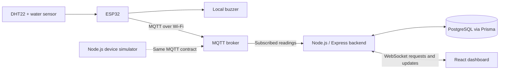
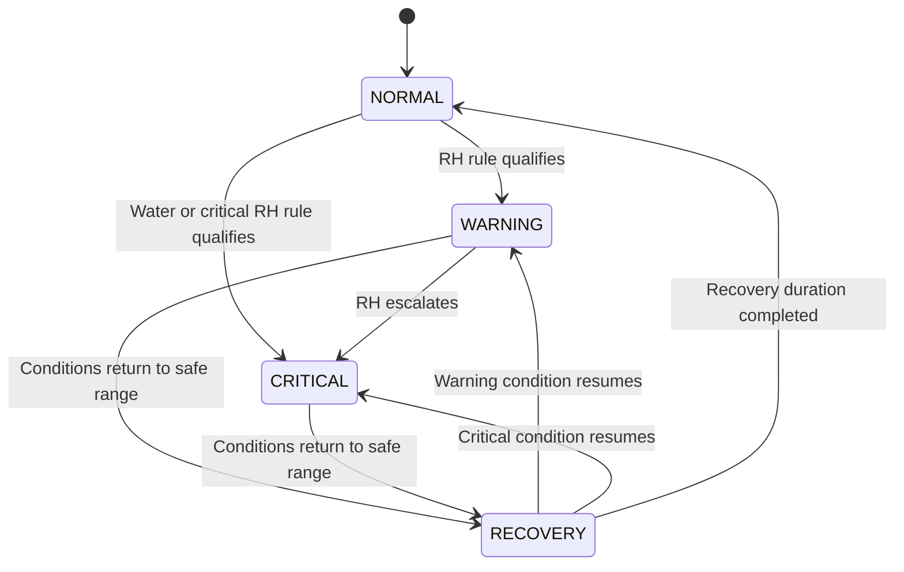

# Software Requirements Specification (SRS)

## ESP32-Based Early-Warning System for Humidity and Water Intrusion in School Document Storage Areas

| Document field | Value |
|---|---|
| Document type | Software Requirements Specification (SRS) |
| Document ID | SRS-DSMS-001 |
| Revision | 1.1 - Communication architecture aligned |
| Date | November 10, 2026 |
| Project acronym | DSMS (Document Storage Monitoring System) |
| Deployment | One school document-storage area; one ESP32 prototype |
| Technology | ESP32 + DHT22 + water sensor + buzzer; React/Vite; Node.js/Express with MQTT and WebSocket; PostgreSQL/Prisma |
| Status | Draft: implementation details and acceptance targets require team/instructor approval |

> **Requirement status key:** **Baseline** = carried forward from the group's visual project guide; **Proposed** = implementation decision added to make the requirements testable; **Excluded** = outside the agreed system. All times, thresholds, performance targets, and policies marked *Proposed* must be approved or revised during design review. This document describes the intended system; it does not claim the system has already been implemented, validated, or approved by a school.

---

## Document control

| Revision | Date | Summary | Approval |
|---|---|---|---|
| 1.0 | 2026-11-05 | Original baseline draft | Pending |
| 1.1 | 2026-11-10 | MQTT/broker and WebSocket selected; schema alignment | Transport agreed; detailed contracts proposed |

**Primary project source:** *ESP32 Document Storage Monitoring — Full Visual Guide* (November 2026), itself based on the group's original *Early-Warning System for Humidity and Water Intrusion in School Document Storage Areas* draft. The source established the project scope, four core functions, ESP32-only controller, component list, basic architecture, proposed alert rules, three database models, endpoints, and research objectives. Details not fixed by that guide are labeled *Proposed* or excluded here.

**Approval responsibilities (to fill in):** Project group: __________; Faculty adviser/instructor: __________; Target storage-area representative: __________.

> Current communication contracts: [COMMUNICATION.md](COMMUNICATION.md). Transport selection is agreed; topic names, event names and QoS details are proposed. Features and warning thresholds are unchanged.

## 1. Introduction

### 1.1 Purpose

This SRS defines the required behavior, interfaces, data, quality attributes, constraints, and acceptance criteria for DSMS. It will guide software development, ESP32 firmware integration, testing, and research evaluation. Intended readers are the project members, instructor, adviser, evaluators, and prospective storage-area staff.

### 1.2 Problem statement

Schools retain paper records such as student files, certificates, enrollment documents, and administrative papers. Prolonged high relative humidity may contribute to conditions favorable to mold, while direct water intrusion may physically damage documents. Occasional manual inspections may miss developing incidents. DSMS shall provide continuous monitoring and earlier warnings **of environmental conditions**, not a guarantee of document preservation.

### 1.3 Product scope

**In scope - agreed system:**

1. Monitor air temperature and relative humidity near one document-storage location using one DHT22 sensor connected to one ESP32.
2. Detect water contacting a water-sensor plate installed near a plausible leak point.
3. Apply local warning rules and operate an audible buzzer even if Wi-Fi is temporarily unavailable.
4. Publish readings via Wi-Fi/MQTT to a broker subscribed to by the Node.js/Express backend.
5. Validate, persist, and retrieve readings in PostgreSQL through a data-access layer (Prisma is recommended).
6. Show current temperature, relative humidity, water status, warning state, device connectivity, and timestamps on a React dashboard.
7. Display reading history and alert/incident history for the monitored area.
8. Support a software MQTT publisher for repeatable integration testing independently of physical hardware.
9. Test measurement error, warning response time, false alarms, water-detection success, and data completeness.

**Out of scope:** automatic dehumidification, automatic pumps/valves, mold identification, direct measurements inside documents, autonomous room climate control, multiple rooms, AI prediction, cloud/SMS integrations, public internet deployment, commercial archival certification, and camera surveillance. Operator login and alert acknowledgment are also out of scope; no expansion roadmap is committed.

### 1.4 Objectives

**General objective:** Develop and evaluate a low-cost ESP32-based system that monitors humidity and water intrusion and provides early warnings in a school document-storage area.

**Specific objectives:** (SO-01) acquire temperature/humidity and water-detection data; (SO-02) generate persistent-condition and immediate-wetness alerts; (SO-03) store and visualize readings/incidents through a WebSocket dashboard; (SO-04) evaluate accuracy, alert responsiveness, reliability, and false-alarm behavior through controlled testing.

### 1.5 Definitions and abbreviations

| Term | Definition |
|---|---|
| ESP32 | Wi-Fi-capable microcontroller used as the **only** microcontroller board |
| DHT22 | Digital sensor measuring ambient temperature and relative humidity |
| Relative humidity (RH) | Percentage measure of water vapor in air relative to saturation at the same temperature |
| Water intrusion | Water detected at the installed probe's physical location |
| Reading | One device report containing temperature, RH, wet/dry status, and a receipt timestamp |
| Alert / incident | Recorded interval in which a warning condition is active |
| MQTT | Device publish/subscribe protocol through a broker |
| WebSocket | Bidirectional browser/backend connection for read requests and live updates |
| Stale data | Last reading too old to describe current conditions reliably |
| MVP | Minimum viable prototype: the agreed scope |
| UTC | Coordinated Universal Time, used for stored timestamps |
| LAN | Local area network connecting device, browser, and backend |

### 1.6 References

- Group source: *ESP32 Document Storage Monitoring — Full Visual Guide*, November 2026.
- Library of Congress, *How do I preserve my letters or paper documents?* — <https://ask.loc.gov/preservation/faq/445765>.
- U.S. National Archives, *How to Preserve Family Archives* — <https://www.archives.gov/preservation/family-archives/storing>.
- Mermaid ER diagram syntax — <https://mermaid.js.org/syntax/entityRelationshipDiagram.html>.
- VS Code Markdown and Mermaid preview — <https://code.visualstudio.com/docs/languages/markdown>.

The preservation sources explain environmental risks; they do **not** automatically validate particular alert thresholds or assert that a wet/dry plate measures moisture inside paper.

---

## 2. Overall description

### 2.1 System perspective

DSMS has five parts: the ESP32 monitoring node and local buzzer, an MQTT broker, the Node.js/Express backend with MQTT subscriber and WebSocket server, PostgreSQL through Prisma, and the React dashboard.



The backend validates authorized messages, persists readings/incidents, then pushes dashboard updates. The broker is a router, not the historical database. The simulator replaces the producer only. Topic/event details and failure boundaries are proposed in [COMMUNICATION.md](COMMUNICATION.md); networking is not yet implemented.

### 2.2 Users and stakeholders

| Actor | Interest / permitted behavior |
|---|---|
| Storage caretaker / school staff | View current status, trends, incidents, and device connectivity; inspect conditions after a warning |
| Project developer/tester | Configure test thresholds, run simulations, inspect message contracts, validate hardware and measurements |
| Instructor / researcher | Evaluate requirements coverage and measured test results |
| ESP32 / simulator (machine actor) | Submit readings using a device-specific credential; cannot perform staff operations |

**Proposed MVP access model:** dashboards run only on a trusted school/lab private LAN and are read-only. Private network placement is not a substitute for authentication if the system is later opened to other users or networks. Protected staff actions are outside the agreed scope.

### 2.3 Operating environment

- One ESP32 DevKit-style board, with on-board Wi-Fi and appropriate regulated USB power.
- DHT22 sensor module, basic exposed-electrode water-detection module, and compatible active buzzer module.
- Laptop/desktop running a compatible current Node.js LTS runtime, Express backend, PostgreSQL, and the Vite development server.
- Modern browser on desktop or mobile connected to the same authorized local network.
- Firmware written in C/C++ using an ESP32-compatible development environment. **No Arduino microcontroller board.** If the course disallows the Arduino *software framework*, use Espressif ESP-IDF; otherwise PlatformIO and its ESP32 framework choice must be approved.

### 2.4 Constraints and dependencies

- The system uses **one ESP32, one DHT22, one water-sensing location, and one buzzer**.
- ESP32 GPIOs are 3.3V logic; no 5V sensor output may directly drive a GPIO.
- Sensor module wiring, trigger polarity, and USB connector vary by purchased model and must be checked against datasheets.
- Local buzzer operation must not depend on the network, backend, database, or React application being online.
- Reading receipt and incident history require a working broker/backend/database. An offline buffered upload queue is **not** a required feature.
- Long-term operation of low-cost exposed-electrode water probes requires inspection for corrosion and false triggers.
- Preset RH thresholds are **experimental starting points** and require site-specific review.

### 2.5 Assumptions

- The ESP32 and backend can each reach the MQTT broker on a trusted private network in integration testing.
- The monitored storage space permits sensor installation and safe routing of power/signal wiring.
- The project group has access to a laptop, internet for package installation, and a reference hygrometer during validation.
- No personally identifiable information from stored school records is collected; DSMS measures environmental conditions, not document contents.

---

## 3. External interface requirements

### 3.1 Hardware interfaces

| Component | Proposed interface | Function / constraint |
|---|---|---|
| DHT22 module | VCC 3.3V, GND, DATA to GPIO 4 | Read temperature °C and RH %; bare DHT22 may need pull-up resistor |
| Water-detection module | VCC/GND as supported; DO to GPIO 27 | Digital wet/dry input; check output is ESP32-safe |
| Active buzzer | SIG GPIO 26 + compatible supply/driver | Provide local audible warning; confirm active-high/active-low |
| ESP32 power | Suitable USB cable and regulated 5V USB power | Maintain safe continuous operation |
| Alternative analog water input | ADC1-capable GPIO such as GPIO 34 | **Optional** only if the purchased module uses analog output |

These GPIO assignments are **proposed starting values**, not final wiring instructions. Complete pinout validation after hardware is purchased. Locate the DHT22 in representative ambient air and the water plate low near the identified intrusion risk; protect the ESP32 from wetting.

### 3.2 Software interfaces

- **Firmware -> broker -> backend:** JSON MQTT publications with device-specific broker credentials and topic ACLs. Backend checks topic/payload identity and registered enabled device.
- **Frontend <-> backend:** WebSocket read requests, responses and live updates. Browser never contacts PostgreSQL or receives broker/device secrets.
- **Backend -> database:** Prisma and PostgreSQL; database credentials remain backend-only.
- **Configuration:** database URL, broker address/credentials, backend port and allowed WebSocket origins. No secrets in Git.
- **Diagnostic HTTP:** a health endpoint can report backend/database/broker dependency status; it is not the device or dashboard data transport.

### 3.3 User interface requirements

| UI area | Required content |
|---|---|
| Dashboard | Area/device label, temperature, RH, wet/dry state, overall warning severity, last update |
| History chart | Time-series temperature and RH with range selection and accessible labels |
| Incident history | Alert type, severity, start, cleared time |
| Connectivity | ONLINE / STALE / OFFLINE badge and a visible last-received timestamp |
| Empty/error states | Descriptive text when no readings, backend connection errors, or outdated values occur |

The first release may implement these as sections of a **single page**. Do not require separate authentication or multi-page routing to meet the MVP.

### 3.4 Communication interfaces

- UTF-8 JSON over MQTT and WebSocket on the controlled LAN; MQTT over TLS and WSS for untrusted networks.
- Use the broker LAN address from the ESP32, and backend WebSocket address from React. Device localhost is not the laptop.
- Server receipt timestamps use UTC and are serialized as ISO 8601; PostgreSQL timestamps are timezone-aware.
- Validate WebSocket Origin explicitly; CORS is not a substitute for upgrade authorization.
- Reconnect with backoff and re-fetch state/history over WebSocket. MQTT delivery acknowledgment is not proof of database persistence.

---

## 4. Functional requirements

**Priorities:** **MUST** = release-blocking MVP requirement; **SHOULD** = strongly recommended for release readiness; **LATER** = excluded from MVP. Each requirement is independently testable. Unless noted otherwise, these requirements are *Proposed* elaborations of the baseline features.

### 4.1 Device acquisition and local warnings

| ID | Priority | Requirement | Verification |
|---|---|---|---|
| FR-001 | MUST | Read valid temperature and RH values from the DHT22 on the ESP32. | Controlled DHT22 test |
| FR-002 | MUST | Read a wet/dry state from the installed water sensor. | Dry/wet probe trials |
| FR-003 | MUST | Provide a configurable acquisition interval; initial target **60 seconds** for temperature/RH (*Proposed*). | Timestamp inspection |
| FR-004 | MUST | Ignore and flag failed/invalid sensor reads rather than using placeholder numbers as real measurements. | Disconnect/invalid read test |
| FR-005 | MUST | Activate the local buzzer when water is detected, without relying on Wi-Fi. | Wi-Fi disabled, wet probe |
| FR-006 | MUST | Implement local humidity warning criteria consistent with Section 5 using measured elapsed time, not a simple one-sample threshold. | Simulated-duration test |
| FR-007 | SHOULD | Use a short, configurable confirmation/debounce for intermittent water-sensor noise, while warning promptly for sustained wet detection. | Repeatable brief/sustained wet pulses |
| FR-008 | MUST | Restart into a safe monitoring state after power restoration and reconnect Wi-Fi without blocking local sensor checks. | Restart/network outage test |
| FR-009 | MUST | Never present stale cached sensor readings as new observations. | Network/reboot test |

### 4.2 Sensor submission and validation

| ID | Priority | Requirement | Verification |
|---|---|---|---|
| FR-010 | MUST | Publish the current sensor state as JSON on the authorized MQTT readings topic at a configurable interval, initially **60 seconds** (*Proposed*). | MQTT/DB log inspection |
| FR-011 | MUST | Accept the same JSON payload from the ESP32 or the Node.js simulator. | Contract comparison |
| FR-012 | MUST | Authenticate MQTT clients and enforce topic ACLs; backend rejects unknown/inactive or mismatched devices. | Unauthorized request tests |
| FR-013 | MUST | Validate `deviceId`, finite temperature/RH numbers, and boolean `waterDetected`; reject malformed payloads with a structured error. | Zod schema tests |
| FR-014 | MUST | Record a server-generated `receivedAt` timestamp on successful storage. | Database inspection |
| FR-015 | SHOULD | Support a unique optional `readingUid` to deduplicate retried submissions; when present, repeated requests shall not create a second measurement. | MQTT redelivery test |
| FR-016 | MUST | Record ingestion outcomes and emit WebSocket updates only after commit; broker acknowledgment alone does not prove storage. | MQTT/DB/WebSocket tests |

### 4.3 Persistence, alert creation, and lifecycle

| ID | Priority | Requirement | Verification |
|---|---|---|---|
| FR-017 | MUST | Store each accepted observation with its related device. | DB foreign-key test |
| FR-018 | MUST | Determine humidity warning eligibility based on continuous qualifying readings over elapsed time. | Alert timer unit test |
| FR-019 | MUST | Create a critical water-intrusion alert promptly upon confirmed wet detection. | Water test |
| FR-020 | MUST | Avoid duplicate **active alerts of the same type** for one device; new observations update the existing incident. | Repeated MQTT message test |
| FR-021 | MUST | Support severity escalation from humidity WARNING to CRITICAL within the same incident. | Escalation test |
| FR-022 | MUST | Record when an incident starts and clears, preserving its highest severity reached. | Incident timeline test |
| FR-023 | MUST | Keep humidity and water incidents independent so both can exist simultaneously. | Combined-condition test |
| FR-024 | MUST | Recalculate a device's overall displayed severity from current incident states: CRITICAL before WARNING before NORMAL. | Priority test |
| FR-025 | SHOULD | Automatically resolve an active warning only after the condition meets a documented recovery rule (Section 5). | Recovery test |
| FR-026 | MUST | Return history records in stable timestamp order and support bounded queries. | Pagination and ordering test |

### 4.4 Dashboard and reporting

| ID | Priority | Requirement | Verification |
|---|---|---|---|
| FR-027 | MUST | Display the newest accepted temperature, humidity, water state, and received-at time. | Browser/persisted-event comparison |
| FR-028 | MUST | Distinguish NORMAL, WARNING, CRITICAL, STALE, and OFFLINE states; missing data shall not be treated as NORMAL. | State cases |
| FR-029 | MUST | Show historical measurements as a time-series chart. | Chart inspection |
| FR-030 | MUST | Show a table of incidents with event type, severity, start, state, and cleared time if available. | Incident table test |
| FR-031 | MUST | Show a helpful empty state when no reading exists for the selected device. | Empty DB test |
| FR-032 | MUST | Handle backend/WebSocket failures and display a visible error/retry state rather than silently keeping stale values. | Stop backend/socket test |
| FR-033 | SHOULD | Request snapshot/history on WebSocket connection and reconnection, then apply live events; chart history may load on demand. | Browser network inspection |
| FR-034 | SHOULD | Filter history by a bounded interval (e.g., 24 hours or 7 days) and display units and timestamps clearly. | Filter test |

### 4.5 Testing and simulation

| ID | Priority | Requirement | Verification |
|---|---|---|---|
| FR-035 | MUST | Provide a Node.js simulator that sends normal, warning, critical, dry, and wet readings using the same MQTT contract as the ESP32. | Simulator runs |
| FR-036 | MUST | Permit automated tests of persistence timing using a controlled/test clock or configurable thresholds, without physically waiting 30 minutes for every case. | Unit test suite |
| FR-037 | MUST | Provide a documented health endpoint for verifying backend process, database and broker dependency status. | Health checks |
| FR-038 | SHOULD | Capture test results for sensor error, detection accuracy, alert latency, false alarms, and accepted-versus-sent readings. | Research report |

### 4.6 Scope boundary

Staff accounts, acknowledgment workflows, remote controls and settings pages are not included. Changing transports adds no new user-facing feature or entity. No second-version roadmap is committed.

---

## 5. Business rules and warning state machine

### 5.1 Experimental alert thresholds

The original project guide proposed the following test thresholds. They are **not conservation standards** and must be validated with literature, actual storage needs, and controlled experiments.

| Rule ID | Condition | Result | Status |
|---|---|---|---|
| BR-001 | RH < 60% with no water detected | NORMAL unless another active event remains pending recovery | Baseline |
| BR-002 | RH >= 60% continuously for 30 minutes | Humidity WARNING | Baseline; proposed test setting |
| BR-003 | RH >= 65% continuously for 15 minutes | Humidity CRITICAL; escalate active humidity incident if any | Baseline; proposed test setting |
| BR-004 | Water sensor confirms wet state | Water CRITICAL; local buzzer; log incident | Baseline |
| BR-005 | Qualifying RH streak is interrupted by an RH reading below its threshold | Reset the corresponding qualification timer | Proposed |
| BR-006 | RH < 58% for 10 minutes | Clear active humidity incident if no qualifying condition resumes | Proposed hysteresis and recovery rule |
| BR-007 | Water sensor remains dry for 10 seconds | Clear active water incident; retain history | Proposed recovery rule |
| BR-008 | Latest `receivedAt` age > 180 seconds | Mark data STALE even if previous severity was NORMAL | Proposed |
| BR-009 | Latest `receivedAt` age > 300 seconds | Mark device OFFLINE; preserve previously recorded incidents | Proposed |
| BR-010 | No accepted reading has ever been received | Display NO DATA / awaiting first reading, not NORMAL | Proposed |

**Precedence:** Show environmental severity and connectivity separately (e.g., `CRITICAL · device offline`). Never hide an earlier unresolved warning simply because the device stopped reporting. Humidity and water incidents are separate. Implement humidity timers from accepted observations and their receipt timestamps, with a deliberate data-gap policy; missing readings beyond the expected interval must not be interpreted as continuous stable humidity. The duration of a gap that breaks a qualifying streak is **Proposed: 180 seconds**. For precise tests, use controllable time in the service layer.

### 5.2 Incident lifecycle



The diagram describes environmental *rule state*; the database holds one incident per active alert type, with `startedAt` and `clearedAt`. Staff acknowledgment is outside scope.

### 5.3 Sample data intervals

| Setting | Initial value | Status |
|---|---|---|
| Temperature/RH sample and MQTT publish interval | 60 seconds | Proposed |
| Water contact check | At least once per second or interrupt-driven if hardware supports it | Proposed |
| Dashboard summary delivery | Snapshot on connect/reconnect; live events after persistence | Selected transport |
| Data stale limit | 180 seconds after last accepted reading | Proposed |
| Offline indication | 300 seconds after last accepted reading | Proposed |
| Display timezone | Asia/Manila in browser; UTC in database/messages | Proposed |

---

## 6. Use cases and main workflows

### UC-01 — Observe document storage conditions

- **Primary actor:** Storage caretaker.
- **Precondition:** At least one valid reading exists; the dashboard can reach the WebSocket server.
- **Trigger:** User opens the dashboard.
- **Main flow:** (1) Browser requests summary over WebSocket; (2) backend fetches latest reading, active incidents, and device metadata; (3) browser displays RH, °C, wet/dry, latest update, and risk/connectivity status; (4) dashboard receives committed WebSocket updates.
- **Alternative flows:** No readings -> show awaiting data; Backend/socket unavailable -> show connection error; last reading too old -> show STALE/OFFLINE.
- **Postcondition:** User sees current or explicitly out-of-date system status.

### UC-02 — Detect water intrusion

- **Primary actor:** ESP32 / simulator.
- **Precondition:** Water sensor installed, or simulator in wet scenario.
- **Trigger:** Probe changes to wet.
- **Main flow:** (1) ESP32 detects the condition; (2) buzzer activates locally; (3) MQTT reports wet state when Wi-Fi is available; (4) backend creates/updates the active water incident; (5) frontend shows critical warning.
- **Alternative flow:** Wi-Fi unavailable -> buzzer still activates; remote dashboard does not update and eventually displays stale/offline state.
- **Postcondition:** Local warning exists and any successfully received incident is stored.

### UC-03 — Detect prolonged high humidity

- **Primary actor:** ESP32 and backend.
- **Trigger:** Consecutive valid RH readings remain above a configured threshold for the duration in BR-002 or BR-003.
- **Main flow:** (1) Qualifying period starts; (2) duration reaches threshold; (3) warning/critical alert is activated; (4) backend records the incident; (5) dashboard shows severity and start time.
- **Alternative flow:** Reading falls below threshold or data gap exceeds allowed window -> timer is reset according to the rule.

### UC-04 — Examine incident history

- **Primary actor:** Storage caretaker / researcher.
- **Main flow:** (1) User opens incident table; (2) frontend requests bounded alert records; (3) backend returns incidents with timestamps and current state; (4) user reviews recurring environmental events.
- **Postcondition:** Past incidents remain available after clearance.

### UC-05 — Run without physical hardware

- **Primary actor:** Developer.
- **Precondition:** Broker, backend and database running; simulator configured with permitted broker credential and topic ACL.
- **Main flow:** (1) Developer selects simulator scenario; (2) script submits the standard readings payload; (3) backend validates/stores it and calculates alerts; (4) dashboard shows the result; (5) developer compares broker/backend logs, database, and UI.
- **Postcondition:** Complete software pathway verified before hardware procurement.

### UC-06 — Recover from temporary disconnection

- **Primary actor:** ESP32 / backend.
- **Trigger:** Wi-Fi or server unavailable.
- **Main flow:** (1) Firmware continues sensing and sounding relevant local alarms; (2) failed MQTT publication is logged locally/diagnostically; (3) dashboard marks data as STALE/OFFLINE as time passes; (4) on reconnection the device resumes publishing current readings.
- **Postcondition:** Network failures are visible; no fictitious observations are created.
- **Limitation:** The system does not guarantee reconstruction of measurements missed while offline.

---

## 7. MQTT and WebSocket specification

[COMMUNICATION.md](COMMUNICATION.md) defines the proposed contracts and examples. MQTT broker product and WebSocket library are not selected by this specification. A plain WebSocket client cannot connect to Socket.IO without its corresponding protocol implementation.

### 7.1 Device publications

Publish JSON to `dsms/<deviceCode>/readings`. Payload fields: public `deviceId` (the registered deviceCode), temperatureC, humidityPercent, waterDetected, and readingUid. Resolve deviceCode to the internal integer device ID. readingUid is optional in the schema; MQTT producers should include a stable ID per measurement and reuse it for redelivery.

Validate topic ownership, enabled device and finite values. Proposed temperature bounds remain -20..80 C pending sensor review; RH must be 0..100. Use QoS 1 and non-retained telemetry as proposed defaults, with a compatible firmware library. Duplicate IDs must not create duplicate records or refresh old timestamps. Invalid messages are rejected/logged without a DB write. Transport acknowledgment is not a persisted success response; no HTTP status or API-key header is used for sensor submission.

### 7.2 Dashboard requests and events

| Request/event | Direction | Purpose |
|---|---|---|
| dashboard.get / dashboard.snapshot | Browser request / backend response | Current device, latest reading, active incidents, risk and freshness |
| readings.get / readings.result | Browser request / backend response | Bounded measurement history |
| alerts.get / alerts.result | Browser request / backend response | Bounded incident history |
| reading.created | Backend push | Newly committed reading |
| alert.changed | Backend push | Incident open/escalation/clear after commit |
| device.status | Backend push | Freshness change, including during device silence |
| error | Backend response | Safe code/message and matching requestId |

History uses deviceCode, optional from/to and limit (default 100, maximum 500 proposed), stable timestamp/ID order and requestId correlation. All dashboard operations remain read-only. On initial connection/reconnection, request snapshot and history and reconcile them with live events without overwriting newer data. Show socket connection status separately from sensor freshness. No staff actions or remote-device commands are introduced.

### 7.3 Processing sequence

```mermaid
sequenceDiagram
    participant D as ESP32 or simulator
    participant B as MQTT broker
    participant A as Backend
    participant P as PostgreSQL
    participant U as React
    D->>B: Publish reading on authorized topic
    B->>A: Deliver subscribed reading
    A->>A: Validate identity and payload; deduplicate
    A->>P: Transaction: reading and incident updates
    P-->>A: Commit
    A-->>U: WebSocket reading.created / alert.changed
    U->>A: WebSocket dashboard.get or history request
    A->>P: Query persisted state
    A-->>U: Correlated snapshot / history response
```

---

## 8. Data requirements and database design

### 8.1 Database conventions

- PostgreSQL relational database with Prisma schema as the selected ORM representation.
- IDs: internal auto-incrementing integer primary keys; external `deviceCode` is a unique human-readable identifier.
- All times stored as timestamp with timezone (UTC semantics) and returned in ISO 8601 UTC.
- Foreign keys shall preserve relationship integrity; prevent accidental cascade deletion of historical records in the MVP.
- Add indexes appropriate for latest-per-device and history queries.

### 8.2 Core logical ERD

See [ERD.md](ERD.md) for the current three-model diagram, aligned with `backend/prisma/schema.prisma`. Device has many SensorReading and Alert records. Alerts relate to a device rather than one triggering reading because incidents can span many measurements.

### 8.3 Data dictionary

| Entity | Fields |
|---|---|
| Device | Integer generated id; unique TEXT deviceCode; TEXT name/location; Boolean isActive default true; timezone-aware createdAt and updatedAt |
| SensorReading | Integer generated id; integer deviceId foreign key; Float temperatureC/humidityPercent; Boolean waterDetected; nullable TEXT readingUid; timezone-aware receivedAt |
| Alert | Integer generated id; integer deviceId foreign key; AlertType, AlertSeverity, AlertStatus; TEXT message; timezone-aware startedAt and nullable clearedAt |

Enums: HUMIDITY/WATER, WARNING/CRITICAL, OPEN/CLEARED. Match camelCase schema fields; no mappings to snake_case or UUID IDs are currently configured. No API-key field is required; broker authentication is separate from database credentials and device identity.

Existing schema/migration includes unique deviceCode, optional compound reading deduplication, device/time indexes and restrictive deletion foreign keys. Additional requirements still need a migration: finite/range checks, alert status/clearedAt consistency, and one OPEN alert per device/type via a partial unique index. Do not use a general unique constraint on device/type/status because it would restrict cleared history. Source files alone do not verify migration application to the database.

### 8.4 Retention, privacy, and backup

- **Proposed:** retain raw readings for a 30-day evaluation period and incident summaries for the study; finalize retention with the instructor and target institution.
- CSV export is outside the agreed scope.
- Store no document titles, student names, personal records, or document contents.
- Make a safe backup of the database during evaluations. Test restoring at least one non-production backup before final demonstration (*Proposed*).

### 8.5 Scope boundary

Device, SensorReading and Alert cover the agreed features. There is no staff-account, acknowledgment, notification-delivery or remote-control entity in the current scope.

---

## 9. Non-functional requirements

These performance and quality targets are **proposed acceptance targets** for a controlled prototype, not claims about measured real-world performance.

| ID | Attribute | Requirement / target | Validation |
|---|---|---|---|
| NFR-001 | Accuracy | Compare RH readings to a reference hygrometer; target absolute difference <= 5 percentage points under controlled conditions, with observed limits reported | Side-by-side calibration test |
| NFR-002 | Water response | Sustained wet contact shall trigger local warning within <= 5 seconds of sensor detection (subject to approved debounce) | Timed trials |
| NFR-003 | Network ingestion latency | 95% of valid LAN MQTT readings reach database commit within 2 seconds under single-device test load | Timed MQTT/DB tests |
| NFR-004 | Dashboard freshness | When backend and browser are available, a newly accepted reading appears within <= 15 seconds | Browser timing test |
| NFR-005 | Data completeness | Target >= 95% accepted/expected samples during a stable one-hour LAN test; report actual rate | Count reconciliation |
| NFR-006 | Connectivity status | Mark age >180s STALE and >300s OFFLINE (configurable thresholds) | Controlled outage test |
| NFR-007 | Robustness | Invalid sensor data shall not corrupt stored history, crash backend, or be treated as normal readings | Fault injection |
| NFR-008 | Availability | Local buzzer shall continue to work when Wi-Fi/broker/backend is unavailable | Disconnect test |
| NFR-009 | Recoverability | Backend shall restart safely without deleting historical readings or duplicating open incidents | Restart test |
| NFR-010 | Security | Device ingestion requires a secret; non-successful auth must not write data; no secrets on frontend or in Git | Broker/WebSocket security tests |
| NFR-011 | Maintainability | Separate frontend, backend, simulator, firmware, configuration, migrations, and test folders | Repository review |
| NFR-012 | Usability | Critical/warning indicators shall use text and/or icons, not color alone; show units and timestamp | UI inspection |
| NFR-013 | Portability | Frontend/browser and backend shall work on an ordinary development laptop and on a private LAN | Multi-browser/local test |
| NFR-014 | Data integrity | Reject malformed readings, maintain foreign keys, and avoid duplicate active incidents | DB/message tests |
| NFR-015 | Privacy | Collect only environmental telemetry, incidents and device metadata | Database inspection |
| NFR-016 | Cost | Aim to remain near the source guide's planning allowance of ₱1,030–₱1,470 for hardware plus validation items, subject to actual quotes | Purchase record |

**Sensor accuracy caveat:** The DHT22 and reference hygrometer may both have error. A low-cost comparison provides practical agreement evidence, not laboratory-grade certification. Record equipment specifications, ambient test conditions, and number of trials.

---

## 10. Security requirements and risk controls

### 10.1 Minimum security for MVP

1. Authenticate devices at the broker and restrict each to its own topic. Backend verifies topic/payload identity and known active deviceCode. Use a separate backend broker account.
2. Keep broker and database credentials out of Git, browser payloads and logs. Prisma's Device stores identity, not broker passwords.
3. Validate MQTT/WebSocket data and bound message sizes, rates, queries and send queues.
4. Limit broker/backend firewall access to the intended private LAN; validate WebSocket Origin. Neither CORS nor deviceCode is authentication.
5. Allow only read-only dashboard requests; no staff administration is included.
6. Use MQTT over TLS and WSS over untrusted networks. Public deployment is outside scope.

### 10.2 Operational safety

- Do not install an exposed water-probe circuit near energized mains wiring.
- Mount the ESP32 and adapter above the potential wet area and keep them dry.
- Use only correctly rated low-voltage adapters; do not connect mains electricity directly to the ESP32.
- Put the probe where it can contact incoming water **without touching archival documents**.
- A detected problem must be treated as a prompt for human inspection, not proof of mold or impending damage.

---

## 11. Implementation architecture and project layout

### 11.1 Selected stack

| Layer | Selected technology | Notes |
|---|---|---|
| Device | ESP32 + C/C++ | ESP32 is the only microcontroller board |
| Firmware IDE/build | VS Code + PlatformIO or ESP-IDF | Framework choice subject to instructor's rule |
| Frontend | React + Vite + JavaScript | One-page responsive dashboard |
| Frontend styling | CSS initially; Tailwind optional | Avoid front-loading unnecessary dependencies |
| Data charts | Recharts | Temperature/RH time series |
| Frontend communication | WebSocket | Snapshot/history requests and live events; library choice pending |
| Device communication | MQTT broker and clients | Device credentials, topic ACLs, non-retained readings |
| Backend runtime | Node.js LTS | ESM is suitable for JavaScript backend |
| Backend framework | Express plus WebSocket server and MQTT subscriber | Diagnostic HTTP may remain |
| Validation | Zod | Incoming MQTT/WebSocket data and filters |
| Data store | PostgreSQL | Persistent records |
| ORM | Prisma | Use version-consistent generator, adapter, and config; do not mix major-version tutorials |
| Local testing | Node.js MQTT simulator + WebSocket test client | Software path can be tested independently of hardware |
| Version control | Git | Track message contracts, migrations, test cases |

### 11.2 Proposed repository structure

```text
document-storage-monitor/
├── frontend/
│   ├── public/
│   ├── src/
│   │   ├── components/
│   │   │   ├── MetricCard.jsx
│   │   │   ├── HumidityChart.jsx
│   │   │   ├── WaterStatus.jsx
│   │   │   ├── DeviceStatus.jsx
│   │   │   └── AlertTable.jsx
│   │   ├── pages/Dashboard.jsx
│   │   ├── services/socket.js
│   │   ├── App.jsx
│   │   └── main.jsx
│   ├── .env.example
│   └── package.json
├── backend/
│   ├── prisma/schema.prisma
│   ├── src/
│   │   ├── routes/
│   │   ├── controllers/
│   │   ├── services/
│   │   ├── middleware/
│   │   ├── app.js
│   │   └── server.js
│   ├── scripts/simulate-device.js
│   ├── tests/
│   ├── .env.example
│   └── package.json
├── firmware/
│   └── (existing PlatformIO ESP32 local prototype; MQTT pending)
├── docs/
│   ├── SRS.md
│   ├── ERD.md
│   └── DEVELOPMENT_GUIDE.md
├── .gitignore
└── README.md
```

For Prisma 7+, its default generator emits TypeScript files and requires a configured output path and SQL driver adapter. Before writing database integration, decide as a team whether to adopt TypeScript for the backend or deliberately configure a supported version-specific JavaScript/legacy generator. **Do not copy a Prisma 6 tutorial directly into Prisma 7+ without checking the corresponding documentation.** The SRS intentionally defines behaviors and entities without falsely claiming one version-independent `schema.prisma` implementation.

---

## 12. Testing, verification, and acceptance

### 12.1 Acceptance test matrix

| Test ID | Requirement(s) | Scenario | Expected result |
|---|---|---|---|
| AT-01 | FR-010–016 | Simulator publishes valid authorized MQTT reading | Reading persisted, then WebSocket event |
| AT-02 | FR-012–013 | Unknown device, invalid broker credential or unauthorized topic | Rejection, no DB insert |
| AT-03 | FR-013 | RH = 140, missing boolean, `NaN`, malformed JSON | Rejected/logged, no DB insert |
| AT-04 | FR-018–021 | RH >= 60% continuously for configured 30 min | One active humidity WARNING |
| AT-05 | FR-021 | RH >= 65% for configured 15 min after warning | Same humidity incident escalates to CRITICAL |
| AT-06 | FR-019,023 | Wet sensor while humidity warning active | Separate CRITICAL water incident, humidity incident retained |
| AT-07 | FR-005, NFR-008 | Disconnect Wi-Fi, wet the probe | Buzzer activates locally |
| AT-08 | FR-020 | Submit repeated qualifying readings | No duplicate open incident of same type |
| AT-09 | FR-025 | RH and water return to configured recovery states | Respective incidents cleared with timestamps |
| AT-10 | FR-027–034 | Load dashboard with stored data | Matching latest readings, chart, incidents, timestamps |
| AT-11 | FR-028, NFR-006 | Stop device submissions | STALE then OFFLINE, old warning still visible |
| AT-12 | FR-031 | Fresh DB with no data | 'Awaiting first reading' state, not NORMAL |
| AT-13 | FR-035–036 | Run scripted normal/warn/critical/wet scenarios with test clock | Consistent incident progression |
| AT-14 | NFR-001 | Compare sensor with reference across recorded conditions | Error computed and documented |
| AT-15 | NFR-003–005 | Sustained 1h simulator integration test | Response/freshness/completeness reported against targets |
| AT-16 | FR-015 | Retry with same optional readingUid | No duplicate stored reading, if feature implemented |

Additional communication acceptance cases: reject a device publishing to another device's topic; simulate broker and database outages without disabling the local alarm; verify a disconnected browser reloads snapshot/history and cannot overwrite newer events; distinguish a connected socket from fresh device data. These tests do not establish guaranteed offline replay.

### 12.2 Research validation plan

- **Humidity error:** collect paired DHT22 and reference hygrometer measurements under a controlled set of conditions; report absolute error in RH percentage points, mean/maximum error, number of trials, and reference limitations.
- **Water detection:** conduct multiple controlled dry/wet tests on a separate tray, away from actual documents; report detected/missed/false activations.
- **Alert latency:** measure elapsed time from condition becoming *eligible* under configured rules to local/remote indication; distinguish the intentionally required 15/30-minute persistence from system processing delay.
- **False alarms:** record events triggered in conditions designated normal by the test protocol, and explain the rule/placement limitations.
- **Data completeness:** compare the number of expected sent reports to records accepted within a stable one-hour LAN trial; explain missing data.
- **Usability:** ask intended caretakers whether severity, location, last-seen time, and incident history are understandable; do not present a subjective survey as technical accuracy.

#### 12.3 Definition of done for the agreed scope

Release is acceptable for a controlled demonstration when: all **MUST** requirements have tests; a simulator-to-broker-to-backend-to-database-to-WebSocket-dashboard workflow functions; the ESP32 can replace the simulator with the same payload contract; the buzzer functions without Wi-Fi; the dashboard correctly shows stale/offline data; all active incidents are deduplicated; the group reports measured results and limitations; and no secrets are committed.

---

## 13. Development plan

| Phase | Deliverable | Exit criterion |
|---|---|---|
| 1. Database | Three models, reviewed migrations, registered device | Persistence and integrity checks pass |
| 2. Broker and ingestion | Credentials/ACLs and backend MQTT subscriber | Authorized data accepted; spoofed/invalid data rejected |
| 3. Device simulator | Node MQTT publisher | One measurement saved; duplicate ignored safely |
| 4. Alert processing | Qualification, escalation, recovery and gap rules | Controlled-clock tests pass |
| 5. WebSocket dashboard | Snapshot/history requests and committed live events | Correct UI state on connect, update and reconnect |
| 6. Physical integration | Individually verified components, Wi-Fi/MQTT firmware | Physical device replaces simulated publisher using same contract |
| 7. Evaluation | Outage, timing, hardware and completeness tests | Results and limitations documented |

### 13.1 First complete data flow

One simulated MQTT reading -> broker -> validated backend -> PostgreSQL -> WebSocket -> React. Physical sensors can be tested separately in Serial Monitor while this software path is developed. See [DEVELOPMENT_GUIDE.md](DEVELOPMENT_GUIDE.md).

---

## 14. Risks, assumptions requiring validation, and unresolved decisions

| ID | Risk / open question | Mitigation / action |
|---|---|---|
| R-01 | User has not yet selected a real school storage site | Interview caretaker, verify operating conditions and install permission |
| R-02 | DHT22 resolution/accuracy may be insufficient for a particular archive | Compare with reference and document uncertainty; decide whether upgrade is justified |
| R-03 | Water probe corrodes or false-triggers | Controlled trials, inspection, replaceable probe, sensor placement review |
| R-04 | ESP32 lacks internet/LAN access | Validate same-LAN routing; local buzzer continues independently |
| R-05 | School requires more strict document conditions | Agree experimental thresholds with adviser/staff; never claim standards compliance |
| R-06 | Requirements expand to many rooms or automatic controls | Keep outside the agreed scope |
| R-07 | Instructor says “ESP32 only” and may mean no Arduino *framework* | Confirm ESP-IDF vs Arduino-ESP32 software tooling separately from hardware restriction |
| R-08 | Current Prisma major version differs from code examples | Pin versions; read version-matched Prisma generator/adapter docs before installing |
| R-09 | Incident timers behave ambiguously during missing readings | Implement explicit >180-second gap rule and test it |
| R-10 | MQTT redelivery or browser reconnect produces duplicate/stale state | Stable readingUid, DB uniqueness, snapshot/event reconciliation and outage tests |

### Decisions to confirm at the team's design review

- [ ] Target school room and actual document types selected.
- [ ] Instructor approves one ESP32 board and chosen firmware framework.
- [ ] Sensor component exact models and electrical compatibility checked.
- [ ] Initial RH thresholds, durations, and recovery policy accepted as experimental values.
- [ ] Sampling rate, stale/offline timing, and WebSocket recovery behavior accepted.
- [ ] JavaScript Prisma client and PostgreSQL adapter integration verified.
- [ ] Read-only LAN access boundaries verified; staff login remains excluded.
- [ ] Research trials, reference instrument, and retention duration approved.

---

## Appendix A — Suggested hardware and approximate planning allowance

This is a **planning** list copied/adapted from the supplied visual guide, not a verified November 2026 price quotation. Exact module photographs and compatible connector types must be confirmed when purchasing.

| Item | Quantity | Approximate allowance (PHP) | Purpose |
|---|---:|---:|---|
| ESP32 DevKit | 1 | 350 | Wi-Fi controller |
| DHT22 module | 1 | 126 | Air temperature and RH |
| Water detection module/probe | 1 | 25 | Surface water presence |
| 3.3V-compatible active buzzer module | 1 | 29 | Audible warning |
| Breadboard + jumper kit | 1 | 70–110 | Prototyping |
| USB data cable | 1 | 50–100 | Firmware upload / power; match connector |
| Regulated 5V USB adapter | 1 | 80–150 | Continuous low-voltage power |
| Protective project enclosure | 1 | 80–150 | Keep controller elevated and dry |
| Mounting materials | 1 set | 30–50 | Placement / cable management |
| Reference hygrometer | 1 | 150–300 | Sensor validation |
| Test tray and dropper | 1 | 40–80 | Water tests |
| **Approximate combined planning allowance** | | **1,030–1,470** | Excludes shipping and unforeseen replacements |

## Appendix B — Intended project outputs

1. Working ESP32 prototype with safe sensor installation and buzzer.
2. Node.js/Express backend with MQTT subscriber, WebSocket interface and tests.
3. PostgreSQL database schema/migrations and seeded device record.
4. React dashboard connected to the backend over WebSocket.
5. Node.js sensor simulator used before hardware integration.
6. Mermaid ERD and technical architecture diagram.
7. Controlled experimental results and documented constraints.

## Appendix C — Diagram companion files

- `COMMUNICATION.md` - selected architecture and proposed messaging contracts.
- `ERD.md` — standalone Mermaid database ERD, cardinals, and explanation.
- `DEVELOPMENT_GUIDE.md` — repository initialization, Mermaid preview directions, software-first workflow, and dependency recommendations.

**End of SRS.**
